<a id="top"></a>

<p align="center">
  <picture>
    <source media="(prefers-color-scheme: dark)" srcset="docs/readme/hero-en-dark.svg">
    
  </picture>
</p>

<p align="center">
  <a href="https://github.com/the-snowpear/omp-studio/releases"></a>
  <a href="https://github.com/the-snowpear/omp-studio/releases"></a>
  <a href="https://github.com/the-snowpear/omp-studio/actions/workflows/ci.yml"></a>
  <a href="#download--install"></a>
  <a href="package.json"></a>
  <a href="LICENSE"></a>
  <a href="https://linux.do/"></a>
</p>

<p align="center">
  <b><a href="#windowed-workbench">0.2.0 Workbench</a></b>
  &nbsp;·&nbsp; <a href="#capabilities">Capabilities</a>
  &nbsp;·&nbsp; <a href="#download--install">Download &amp; Install</a>
  &nbsp;·&nbsp; <a href="#run-from-source">Run from Source</a>
  &nbsp;·&nbsp; <a href="#architecture">Architecture</a>
  &nbsp;·&nbsp; <a href="docs/README.md">Docs</a>
  &nbsp;·&nbsp; <a href="README.md">中文</a>
</p>

<br>

**OMP Studio** is a desktop workbench for [oh-my-pi](https://github.com/can1357/oh-my-pi) (OMP). It brings conversations, approvals, subagents, Git, a terminal, a browser, and model configuration into a single window, talking directly to the Runtime through a typed **Studio Bridge** — without scraping TUI text, parsing ANSI output, or simulating keystrokes.

0.2.0 rebuilds the entire workbench: **conversations and tools can both be dragged into windows, snapped into split layouts, docked to any side, or pinned as independent system windows.** You can run several conversations side by side, each with its own tools.

<p align="center">
  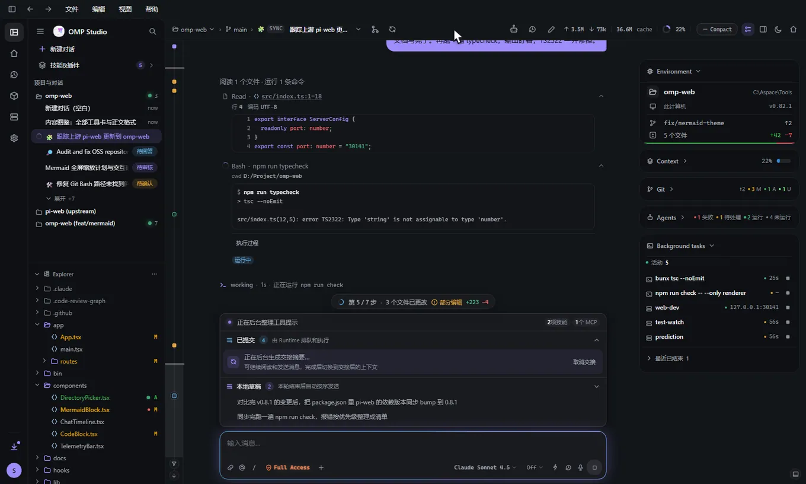
  <br>
  <sub>▲ Drag a header to turn a conversation into a window, snap to edges and corners, and run three conversations side by side (recorded from the live UI with preview-mode demo data)</sub>
</p>

<p align="center">
  <picture>
    <source media="(prefers-color-scheme: dark)" srcset="docs/readme/stats-en-dark.svg">
    
  </picture>
</p>

> [!NOTE]
> **[0.2.3](https://github.com/the-snowpear/omp-studio/releases/tag/v0.2.3)** enables in-app differential updates on Linux (`AppImage` &amp; `deb`), brings the Command Deck and real inter-agent comms into Agent Hub alongside a redesigned Agent Dossier and model fetch filters, and fixes model catalog routing, configuration approvals, and stale workspace recovery (bundled Runtime `18.20.2-studio.6`). See the [release notes](docs/releases/v0.2.3.md) for downloads and upgrade details.

<table>
<tr>
<td width="33%" valign="top">

### Flexible Workbench

Conversations, tools, and web pages share the same window system: float, snap, split, group, minimize, or pin as standalone OS windows. Layouts restore across restarts.

</td>
<td width="34%" valign="top">

### Typed Bridge

The UI communicates with the Runtime via `query` / `command` / `event`. The renderer never receives tokens, process handles, or native paths; unknown mutations fail closed.

</td>
<td width="33%" valign="top">

### All-in-One Local Capabilities

Git, files, terminal, browser, computer use, Time Travel, evaluation, and dictation all live inside the workbench — no hopping between a TUI and a pile of web pages.

</td>
</tr>
</table>

<br>

<a id="windowed-workbench"></a>

## Windowed Workbench

<p align="center">
  <picture>
    <source media="(prefers-color-scheme: dark)" srcset="docs/readme/workbench-dark.webp">
    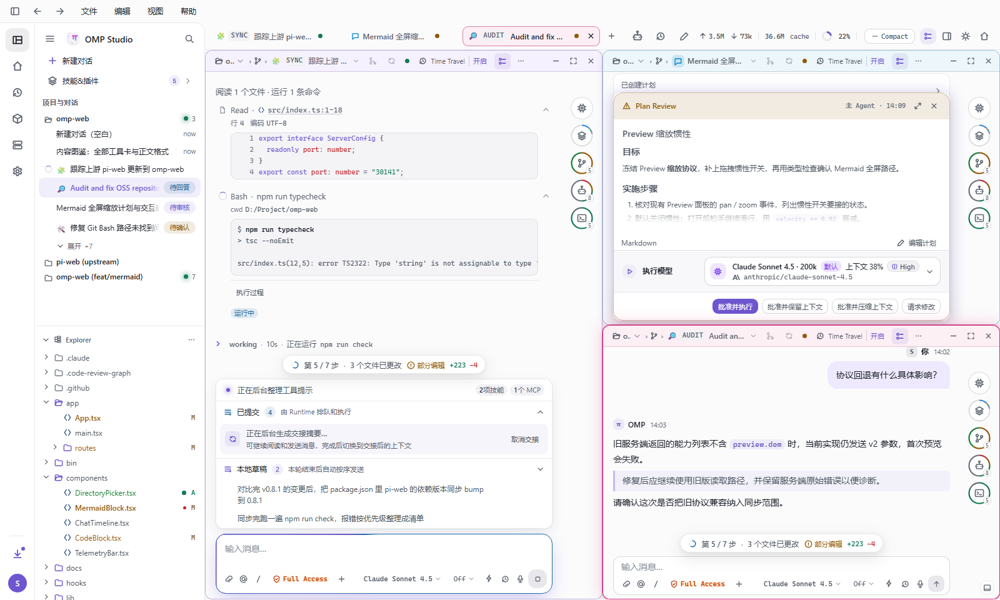
  </picture>
  <br>
  <sub>Two conversations and a browser tool share one partition layout: running commands on the left, waiting on plan review top-right, and a managed browser bottom-right</sub>
</p>

### 1 · Drag Out into a Window

- **Drag a session from the sidebar** outside the list and release to open it as a floating window while keeping the current conversation in place.
- **Drag the main conversation header** to pop out the conversation you are viewing together with its composer and conversation tools.
- Moving, minimizing, or docking back **never recreates the conversation**. Drafts, reading position, and terminal state are all preserved; closing only closes the view and never stops running work.
- Once all conversations are in windows, the main top bar switches to a **window tab bar** — click any tab to focus or restore its window.

### 2 · Snap and Layout Templates

<table>
<tr>
<td width="44%" valign="top">
<picture>
  <source media="(prefers-color-scheme: dark)" srcset="docs/readme/snap-picker-dark.webp">
  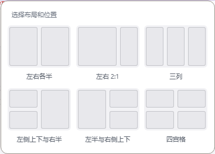
</picture>
</td>
<td valign="top">

- Drag to the **left or right edge** to snap to half the workspace, to a **corner** for a quarter, or to the **top** to maximize. Trigger zones adapt to workspace size so you never have to chase a 1px border.
- **Hover the Maximize button for 300ms** to open the layout picker: Two equal columns, Wide left column (2:1), Three columns, Two stacked left and right, Left and two stacked right, or Four quarters.
- When a new window snaps in, existing windows **automatically move into the largest remaining space** instead of sitting hidden behind the new window.
- Drag a shared divider to resize neighboring windows together; nudge with arrow keys, or double-click to reset default proportions.
- Hold <kbd>Ctrl</kbd> (<kbd>⌘</kbd> on macOS) to temporarily disable snapping, or press <kbd>Esc</kbd> to cancel the drag.

</td>
</tr>
</table>

### 3 · Dock Tools Anywhere

<p align="center">
  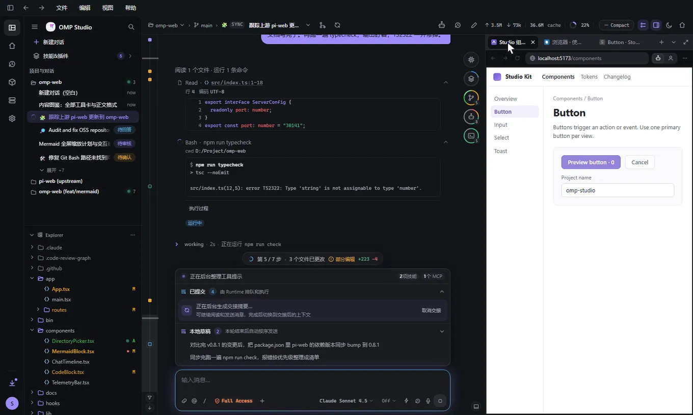
  <br>
  <sub>▲ Drag a browser tab into a floating window snapped left of the conversation, then move OMP Logs from the bottom bar into the right sidebar</sub>
</p>

<p align="center">
  <picture>
    <source media="(prefers-color-scheme: dark)" srcset="docs/readme/zones-en-dark.svg">
    
  </picture>
</p>

Files, Changes, Git, Browser, Computer, Agents, Terminal, Logs, BTW, and more can all move freely across **Left sidebar · Conversation tools · Right sidebar · Bottom bar · Floating window**.

- Dragging past 6px displays a **live-content drop preview** and only commits on release; if you prefer not to drag, right-click or press <kbd>Shift</kbd>+<kbd>F10</kbd> to move, split, merge, or hide from the context menu.
- The right sidebar splits into up to **two stacked groups**, and the bottom bar splits into up to **two side-by-side groups**; floating windows can hold multiple tabs.
- **Conversations can dock too**: drop a conversation window into the right sidebar or bottom bar to keep it as a tab alongside tools.
- Collapsed cards still show summaries — such as Git `M / A / D` counts and ahead/behind status, or Changes file counts and `+/-` line totals.

### 4 · Pin into Independent Windows

A floating window's Pin menu offers **Unpinned · Pin to workspace · Pin to application · Independent window · Always-on-top window**. Independent windows have their own taskbar icon and can be dragged to another display; open windows and their positions restore after a restart.

<details>
<summary><b>Keyboard Shortcuts</b></summary>

| Action | Windows / Linux | macOS |
|---|---|---|
| New conversation | <kbd>Ctrl</kbd>+<kbd>Shift</kbd>+<kbd>O</kbd> | <kbd>⌘</kbd>+<kbd>⇧</kbd>+<kbd>O</kbd> |
| Collapse / expand left sidebar | <kbd>Ctrl</kbd>+<kbd>B</kbd> | <kbd>⌘</kbd>+<kbd>B</kbd> |
| Collapse / expand bottom bar | <kbd>Ctrl</kbd>+<kbd>J</kbd> | <kbd>⌘</kbd>+<kbd>J</kbd> |
| Move focus between regions | <kbd>F6</kbd> / <kbd>Shift</kbd>+<kbd>F6</kbd> | <kbd>F6</kbd> / <kbd>⇧</kbd>+<kbd>F6</kbd> |
| Temporarily disable snapping while dragging | Hold <kbd>Ctrl</kbd> | Hold <kbd>⌘</kbd> |
| Tab / card menu | <kbd>Shift</kbd>+<kbd>F10</kbd> or Menu key | — |
| Cancel drag or close menu | <kbd>Esc</kbd> | <kbd>Esc</kbd> |

Hidden tools can be restored from **View → Tools**; the first-run tutorial can be reopened anytime from **Help → Tutorial**.

</details>

<details>
<summary><b>First-Run Tutorial</b>: 8 animated steps introducing the new workbench</summary>

<p align="center">
  <picture>
    <source media="(prefers-color-scheme: dark)" srcset="docs/readme/tour-dark.webp">
    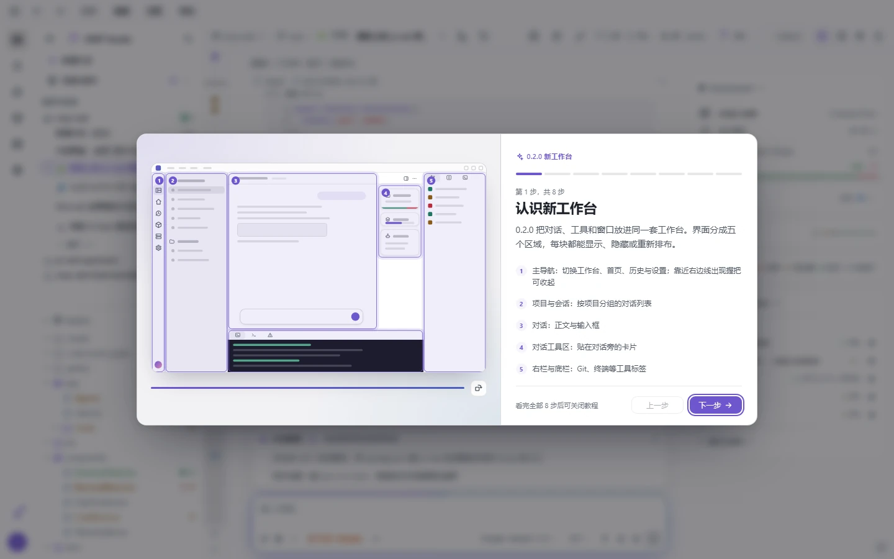
  </picture>
</p>

On first launch into 0.2.0, an 8-step low-fidelity animated tutorial walks through the workbench layout, dragging conversations into windows, snap splitting, docking tools, dragging between tabs and windows, conversation tools, independent windows, and essential shortcuts.

</details>

See [Workbench Docking & Layout](docs/workbench-docking.md) for the full rulebook.

<br>

<a id="capabilities"></a>

## Capabilities

<table>
<tr>
<td width="50%" valign="top">
<picture>
  <source media="(prefers-color-scheme: dark)" srcset="docs/readme/home-dark.webp">
  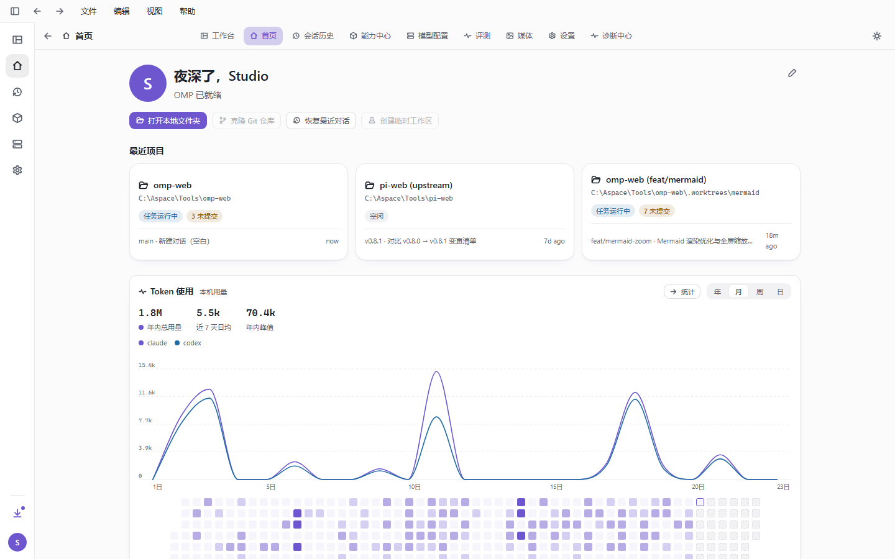
</picture>
<h3>Home &amp; Usage</h3>
Jump back into the workbench from recent projects in one click; switch Token line charts and heatmaps by year, month, week, or day. Expand turn usage, cache hits, and context occupancy anytime from the conversation header.
</td>
<td width="50%" valign="top">
<picture>
  <source media="(prefers-color-scheme: dark)" srcset="docs/readme/history-dark.webp">
  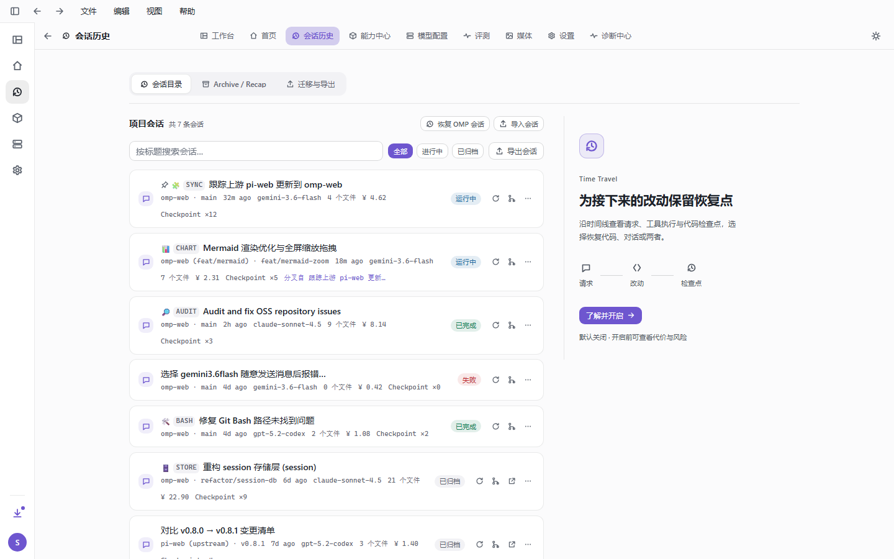
</picture>
<h3>Session History · Time Travel</h3>
Save workspace snapshots per turn, preview file changes, and restore code only, conversation only, or both — with an automatic pre-restore backup. Disabled by default. See <a href="docs/time-travel.md">Time Travel</a>.
</td>
</tr>
<tr>
<td width="50%" valign="top">
<picture>
  <source media="(prefers-color-scheme: dark)" srcset="docs/readme/agent-hub-dark.webp">
  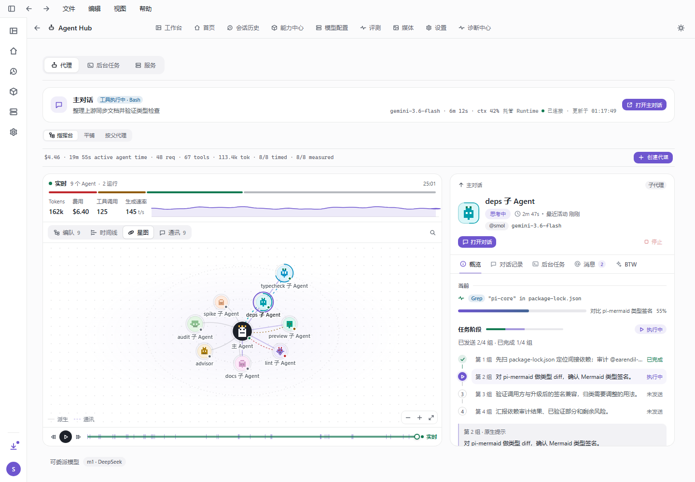
</picture>
<h3>Agent Hub</h3>
Inspect status, request counts, Token usage, and spend for the main conversation and all subagents in one place; supports worker subagents, task files, and per-subagent account policies.
</td>
<td width="50%" valign="top">
<picture>
  <source media="(prefers-color-scheme: dark)" srcset="docs/readme/model-config-dark.webp">
  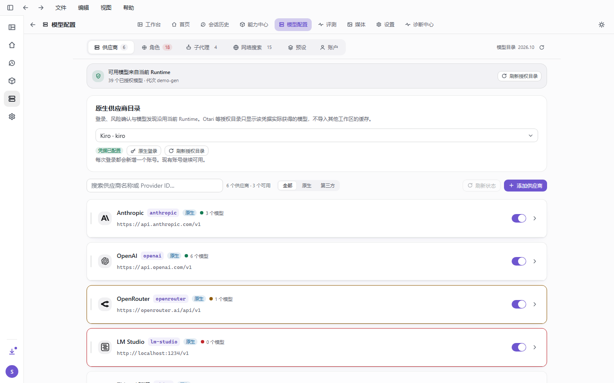
</picture>
<h3>Unified Model Configuration</h3>
Manage toggles, endpoints, and <code>modelProviderOrder</code> for Anthropic, OpenAI, OpenRouter, local LM Studio, and more on a single page; assign separate models and thinking effort to <code>@default</code>, <code>@plan</code>, and <code>@task</code> under Roles.
</td>
</tr>
<tr>
<td width="50%" valign="top">
<picture>
  <source media="(prefers-color-scheme: dark)" srcset="docs/readme/capabilities-dark.webp">
  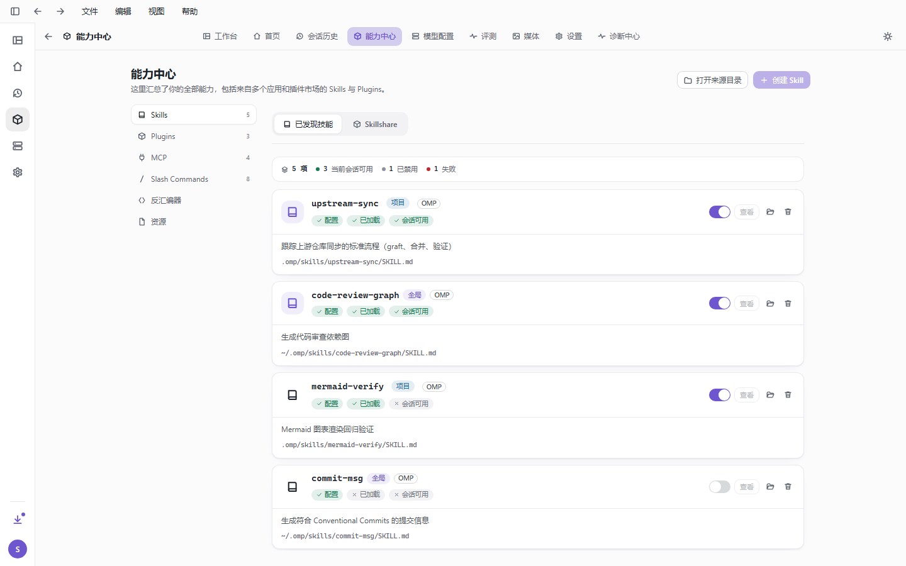
</picture>
<h3>Capabilities Center</h3>
Toggle and probe Skills, Plugins, MCP, and Slash Commands on one page, or open their source folders directly; click <b>Add</b> in the sidebar to drop a Skill right into the current draft.
</td>
<td width="50%" valign="top">
<picture>
  <source media="(prefers-color-scheme: dark)" srcset="docs/readme/settings-dark.webp">
  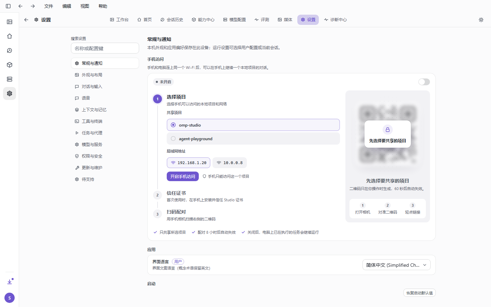
</picture>
<h3>Settings &amp; Updates</h3>
Clearly categorized, searchable settings; Runtime config saves across global, project, and session scopes. In-app updates verify signatures, and optional components install on demand. See <a href="docs/settings.md">Settings</a>.
</td>
</tr>
</table>

<details>
<summary><b>And more</b>: Browser, Computer Use, Git, File Viewer, SSH, Evaluation, Dictation…</summary>

| Capability | Overview | Docs |
|---|---|---|
| **Chat Browser** | Native web pages, multi-tab support, human/Agent control handoff, DevTools, element screenshot references, persistent auth profiles, and native WebMCP | [browser.md](docs/browser.md) |
| **Computer Use** | Action-linked screenshots, visual history, per-session stop and explicit resume, read-only UI structure | [computer-use.md](docs/computer-use.md) |
| **Git / Changes** | Staging, diffs, commits, Fetch / Pull / Push, commit graph, and Worktrees; Changes lists file edits per turn | [feature-index.md](doc/feature-index.md) |
| **File Viewer** | Text editing, Markdown, PDF, images, audio/video, Excel / CSV; Word / PPT via optional component | [file-viewer.md](docs/file-viewer.md) |
| **SSH Workspaces** | Work locally or remotely with system keys or credentials, with bounded remote Runtime recovery (dev preview) | [ssh-workspaces.md](docs/ssh-workspaces.md) |
| **BTW Aside** | Ask side questions without interrupting the main thread; supports images, branching, and subagent reuse | [btw.md](docs/btw.md) |
| **Voice Dictation** | Click or hold Space to dictate at the cursor; recovers audio from memory if transcription fails | [dictation.md](docs/dictation.md) |
| **Evaluation Workspace** | Native benchmarks, instruction-following evals, background runs, history comparison, and Ratchet best-run diff export | [evaluation.md](docs/evaluation.md) |
| **Conversation Details** | Tool cards, Plan / Vibe / approvals, queued & mid-turn replies, Shell replay, prompt cache status, and up to four input predictions | [omp-18.18.0.md](docs/migrations/omp-18.18.0.md) |

</details>

<br>

<a id="download--install"></a>

## Download &amp; Install

| Platform | Package | Notes |
|---|---|---|
| **Windows x64** | `OMP-Studio-Setup-<version>-windows-x64.exe` | Installer with in-app update support |
| **Windows ARM64** | `OMP-Studio-Setup-<version>-windows-arm64.exe` | Snapdragon and other ARM devices |
| **macOS Apple Silicon** | `OMP-Studio-<version>-macos-arm64.dmg` | macOS 13+; ad hoc signed, not yet notarized |
| **Linux x64** | `OMP-Studio-<version>-linux-x64.deb` / `.AppImage` | Ubuntu 24.04 / glibc 2.39+, in-app differential updates; [installation &amp; sandbox guide](docs/linux.md) |

Download from **[GitHub Releases](https://github.com/the-snowpear/omp-studio/releases)**. Exact filenames follow the Release page. Runtime artifacts and update catalogs use Ed25519 signatures; Windows installers are not Authenticode-signed.

<details>
<summary><b>macOS blocked on first launch?</b></summary>

Open the dmg and drag OMP Studio into Applications. This preview build is ad hoc signed and not yet notarized, so Gatekeeper blocks the first launch. Choose either option:

- Open **System Settings › Privacy &amp; Security** and click **Open Anyway**;
- Or run in Terminal:

```bash
xattr -dr com.apple.quarantine "/Applications/OMP Studio.app"
```

You can also run from source following [getting-started.md](docs/getting-started.md), or package it yourself with `npm run pack:mac`.

</details>

> [!TIP]
> Models and login reuse OMP’s `models.yml` / `omp login`. **This repository ships no provider secrets.**

<br>

<a id="run-from-source"></a>

## Run from Source

<p align="center">
  <picture>
    <source media="(prefers-color-scheme: dark)" srcset="docs/readme/quickstart-en-dark.svg">
    
  </picture>
</p>

Requires **Node.js 22+**, Git, and [Bun](https://bun.sh).

```bash
git clone --recurse-submodules https://github.com/the-snowpear/omp-studio.git
cd omp-studio
npm install
npm run omp:overlay:apply
npm run preview
```

On Windows you can also double-click `preview.cmd` at the repository root; macOS requires Xcode Command Line Tools first.

Linux supports running from source and native packaging via `npm run pack:linux`; see [Linux Client](docs/linux.md) for environment setup, installation, updates, and sandbox notes. Official desktop assets are AppImage / deb; Linux remote archives in Releases are for SSH Hosts.

<details>
<summary><b>Attach a real managed Runtime</b> (slower the first time)</summary>

```bash
npm run omp:install-deps     # MSVC Build Tools + Rust (macOS: checks Xcode CLT / rustup / Bun)
npm run omp:overlay:apply    # Apply Studio overlay and seam patches into vendor (idempotent)
npm run omp:keys             # Once per machine: generate local signing keys
npm run omp:build:host       # Build omp --mode studio-host
npm run preview
```

Full steps and troubleshooting: [docs/getting-started.md](docs/getting-started.md).

</details>

<details>
<summary><b>Common developer commands</b></summary>

| Command | Purpose |
|---|---|
| `npm run check` | Architecture constraints, selector rules, compile, and core package &amp; renderer tests |
| `npm run check -- --fast` | Architecture constraints, selector rules, and incremental compile only |
| `npm run check -- --only renderer` | Compile renderer dependency closure and run core renderer tests |
| `npm run check -- --production` | Add Vite production bundle and remote Host artifact checks (used by CI) |
| `启动预览.cmd` / `启动预览版.cmd` | Development previews using real Host data and demo fixtures respectively |
| `npm run omp:patches:regen` | Capture overlay edits from vendor and regenerate seam patches |

See [docs/development.md](docs/development.md) for the inner loop, preview mode, and patch regeneration; check [doc/feature-index.md](doc/feature-index.md) before changing features.

</details>

<br>

<a id="architecture"></a>

## Architecture

<p align="center">
  <picture>
    <source media="(prefers-color-scheme: dark)" srcset="docs/readme/architecture-en-dark.svg">
    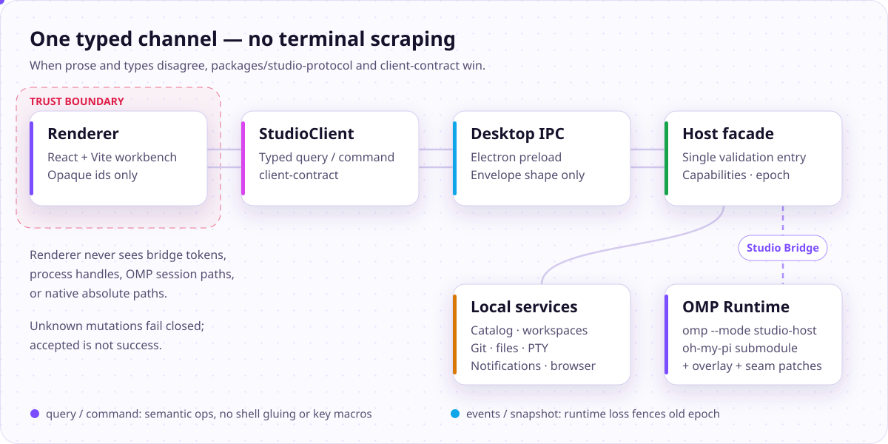
  </picture>
</p>

**Invariants** (see [docs/architecture.md](docs/architecture.md)):

- When prose and types disagree, `packages/studio-protocol` and `client-contract` win.
- The renderer never receives Bridge tokens, process handles, or OMP session paths — only opaque ids.
- Unknown mutations fail closed; `accepted` is not success.
- Runtime loss fences the old epoch and marks unresolved accepted work as `outcome_unknown`.

<details>
<summary><b>Repository Layout</b></summary>

```text
apps/desktop          Electron main process; platform differences live in src/platform/
apps/renderer         Vite + React workbench
packages/             Protocol, Host, client, transports, platform, testkit
omp-patch/overlay     Studio-owned Runtime sources (paths absent upstream)
omp-patch/patches     Seam patches on upstream files in four subsystem groups (do not hand-edit)
omp-patch/vendor      oh-my-pi submodule (commit the gitlink only)
packaging/            Windows NSIS, macOS, and Linux packaging resources
docs/                 User and developer documentation
```

</details>

<details>
<summary><b>How is the Runtime maintained?</b></summary>

The Runtime is pinned to the oh-my-pi submodule, with Studio changes split into two layers:

- **overlay**: Studio-owned files on paths that do not exist upstream — edited as ordinary source without upstream merge conflicts;
- **seam patches**: changes only to existing upstream files, grouped by upstream subsystem into four patch files and regenerated via `npm run omp:patches:regen`.

The managed Runtime launches as `omp --mode studio-host`, and artifacts are Ed25519-verified. See [omp-patch/README.md](omp-patch/README.md).

</details>

<br>

## FAQ

<details>
<summary><b>How does it relate to the omp CLI?</b></summary>

OMP Studio is a desktop shell for `omp`. Models, logins, Skills, and sessions all reuse OMP’s own configuration and formats; Studio invokes the Runtime’s semantic capabilities over the Bridge instead of wrapping a terminal. Please file upstream OMP defects at [can1357/oh-my-pi](https://github.com/can1357/oh-my-pi).

</details>

<details>
<summary><b>Which models are supported? Do I need my own keys?</b></summary>

All providers OMP supports work — such as Anthropic, OpenAI, OpenRouter, local LM Studio, and more. Keys and logins go through OMP’s `models.yml` / `omp login`; this repository ships no keys.

</details>

<details>
<summary><b>Is the data in the screenshots real?</b></summary>

No. Screenshots and animations in the README were recorded in preview mode using demo data; in actual use, the UI displays only real data returned by the Host and your machine.

</details>

<details>
<summary><b>Where can I find logs if something goes wrong?</b></summary>

Host diagnostic logs live at `%APPDATA%\omp-studio\logs\host-YYYY-MM-DD.log` on Windows and `~/Library/Application Support/omp-studio/logs/` on macOS. You can also view them inside the in-app **Diagnostics** page. Please report issues via [Issues](https://github.com/the-snowpear/omp-studio/issues).

</details>

<br>

## Documentation

| Getting Started | Features | Development |
|---|---|---|
| [Run from Source](docs/getting-started.md) | [Workbench Docking &amp; Layout](docs/workbench-docking.md) | [Development Loop](docs/development.md) |
| [Settings](docs/settings.md) | [Time Travel](docs/time-travel.md) | [Architecture &amp; Invariants](docs/architecture.md) |
| [In-App Updates](docs/updates.md) | [Chat Browser](docs/browser.md) · [Computer Use](docs/computer-use.md) | [Feature → File Index](doc/feature-index.md) |
| [Changelog](CHANGELOG.md) | [SSH Workspaces](docs/ssh-workspaces.md) · [File Viewer](docs/file-viewer.md) | [Overlay / Seam Patches](omp-patch/README.md) |
| [All Docs](docs/README.md) | [BTW](docs/btw.md) · [Dictation](docs/dictation.md) · [Evaluation](docs/evaluation.md) | [Release Process](docs/releasing.md) |

## Contributing

Issues and PRs are welcome. Please read [CONTRIBUTING.md](CONTRIBUTING.md) and [CODE_OF_CONDUCT.md](CODE_OF_CONDUCT.md) before getting started. **Do not report security issues in public Issues** — report them privately following [SECURITY.md](SECURITY.md).

Chinese-language discussion, suggestions, and feedback are welcome on the [LINUX DO](https://linux.do/) community — thanks to everyone there for your support.

## License

[MIT](LICENSE). Third-party notices: [NOTICE](NOTICE). The pinned Runtime comes from [oh-my-pi](https://github.com/can1357/oh-my-pi) (MIT; Pi by Mario Zechner, omp by Can Bölük). Studio’s overlay and seam patches are independent work in this repository, also licensed under MIT.

<p align="center">
  <a href="#top">
    <picture>
      <source media="(prefers-color-scheme: dark)" srcset="docs/readme/footer-en-dark.svg">
      
    </picture>
  </a>
</p>
