<a id="top"></a>

<p align="center">
  <picture>
    <source media="(prefers-color-scheme: dark)" srcset="docs/readme/hero-dark.svg">
    
  </picture>
</p>

<p align="center">
  <a href="https://github.com/the-snowpear/omp-studio/releases"></a>
  <a href="https://github.com/the-snowpear/omp-studio/releases"></a>
  <a href="https://github.com/the-snowpear/omp-studio/actions/workflows/ci.yml"></a>
  <a href="#下载安装"></a>
  <a href="package.json"></a>
  <a href="LICENSE"></a>
  <a href="https://linux.do/"></a>
</p>

<p align="center">
  <b><a href="#窗口化工作台">0.2.0 新工作台</a></b>
  &nbsp;·&nbsp; <a href="#能力全景">能力全景</a>
  &nbsp;·&nbsp; <a href="#下载安装">下载安装</a>
  &nbsp;·&nbsp; <a href="#从源码运行">从源码运行</a>
  &nbsp;·&nbsp; <a href="#架构">架构</a>
  &nbsp;·&nbsp; <a href="docs/README.md">文档</a>
  &nbsp;·&nbsp; <a href="README.en.md">English</a>
</p>

<br>

**OMP Studio** 是 [oh-my-pi](https://github.com/can1357/oh-my-pi)（OMP）的桌面工作台。它把对话、审批、子 Agent、Git、终端、浏览器和模型配置放进同一扇窗口，通过类型化的 **Studio Bridge** 直接对接 Runtime，不解析 TUI 文本或 ANSI 输出，也不模拟按键。

0.2.0 重做了整个工作台：**对话和工具都可以拖成窗口，吸附分屏，停到任意一侧，或钉成独立系统窗口。** 你可以同时开几场对话，每场各带自己的工具。

<p align="center">
  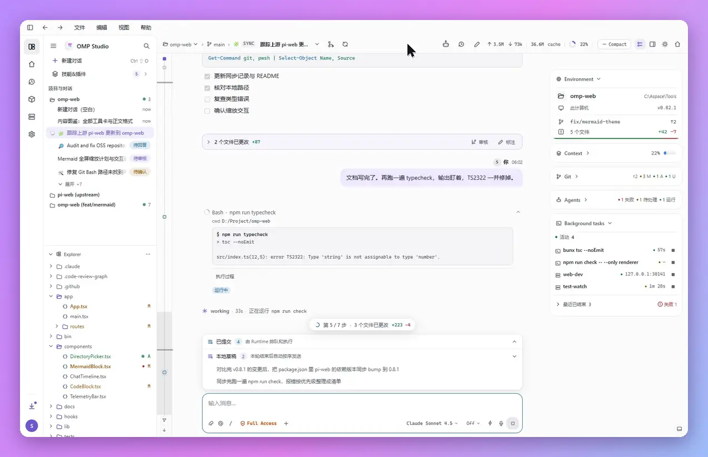
  <br>
  <sub>▲ 拖动顶栏把对话变成窗口，拖到边缘和角落吸附，三场对话并排运行（真实界面录制，预览模式演示数据）</sub>
</p>

<p align="center">
  <picture>
    <source media="(prefers-color-scheme: dark)" srcset="docs/readme/stats-dark.svg">
    
  </picture>
</p>

> [!NOTE]
> 本页介绍的窗口化工作台属于 **0.2.0**，目前在 [`0.2.0`](https://github.com/the-snowpear/omp-studio/tree/0.2.0) 分支开发，尚未发布正式安装包。[Releases](https://github.com/the-snowpear/omp-studio/releases) 中的最新正式版仍是 0.1.x。各项变化与当前验证范围见 [CHANGELOG](CHANGELOG.md#unreleased)。

<table>
<tr>
<td width="33%" valign="top">

### 🪟 自由的工作台
对话、工具和网页使用同一套窗口：浮动、吸附、分屏、成组、最小化，或钉成独立系统窗口。布局在重启后恢复。

</td>
<td width="33%" valign="top">

### 🧬 类型化 Bridge
界面通过 `query` / `command` / `event` 与 Runtime 通信。Renderer 拿不到 token、进程句柄或本机路径；未知写操作一律失败关闭。

</td>
<td width="33%" valign="top">

### 🧰 一站式本机能力
Git、文件、终端、浏览器、电脑操作、Time Travel、评测和语音输入都在工作台内，不必在 TUI 和一堆网页之间切换。

</td>
</tr>
</table>

<br>

<a id="窗口化工作台"></a>

## 窗口化工作台

<p align="center">
  <picture>
    <source media="(prefers-color-scheme: dark)" srcset="docs/readme/workbench-dark.webp">
    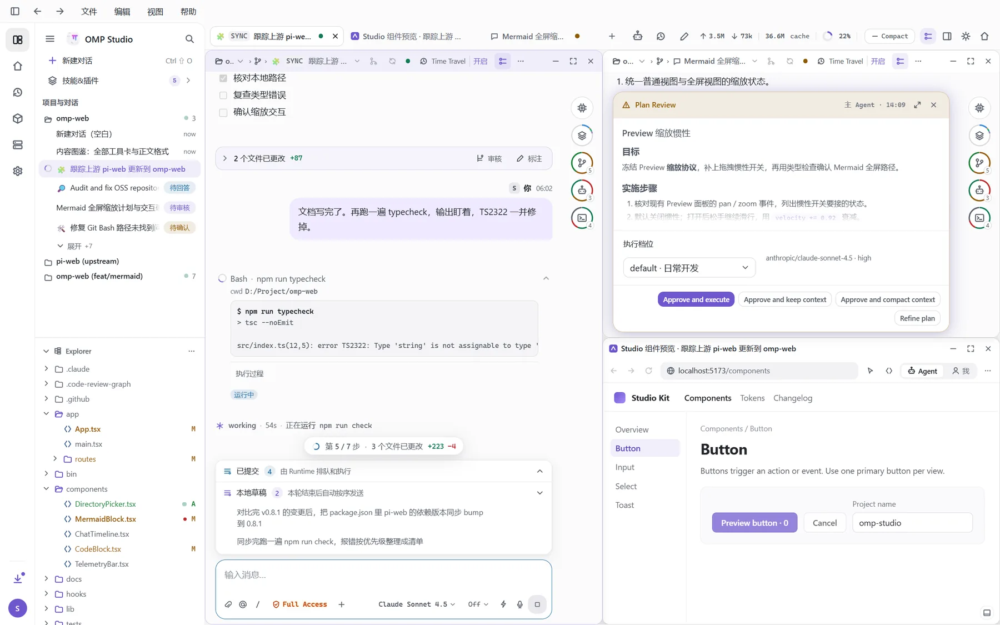
  </picture>
  <br>
  <sub>两场对话和一个网页工具共用一套分区：左边正在跑命令，右上等待审批计划，右下是托管浏览器</sub>
</p>

### 1 · 拖出来就是一个窗口

- **从侧栏拖一场会话**到列表外，松手即打开为浮窗，原来的对话保持不动。
- **拖主对话的顶栏**，正在看的这场对话会连同输入框和对话工具区一起变成浮窗。
- 移动、最小化、收回都**不会重建对话**。草稿、阅读位置和终端状态全部保留；关闭只关闭视图，不会停止任务。
- 全部对话都进入窗口后，主顶栏换成**窗口标签栏**，点击标签即可聚焦或恢复对应窗口。

### 2 · 吸附与布局模板

<table>
<tr>
<td width="44%" valign="top">
<picture>
  <source media="(prefers-color-scheme: dark)" srcset="docs/readme/snap-picker-dark.webp">
  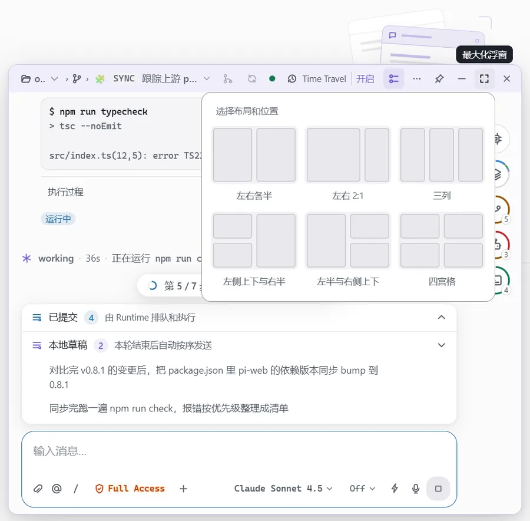
</picture>
</td>
<td valign="top">

- 拖到**左右边缘**吸附为半屏，拖到**四角**为四分之一，拖到**顶部**为最大化。触发区随工作区尺寸自适应，不必把鼠标贴到边框上。
- **悬停最大化按钮 300ms** 打开布局选择器，可选左右各半、2:1、三列、左栏上下分、右栏上下分、四宫格。
- 新窗口吸附进来时，原来的窗口**自动移到剩余最大的空位**，不会留在新窗口背后。
- 拖动共用分界线可联动调整相邻窗口；方向键微调，双击恢复默认比例。
- 按住 <kbd>Ctrl</kbd>（macOS 为 <kbd>⌘</kbd>）可临时关闭吸附，<kbd>Esc</kbd> 取消本次拖动。

</td>
</tr>
</table>

### 3 · 工具可以停在任何地方

<p align="center">
  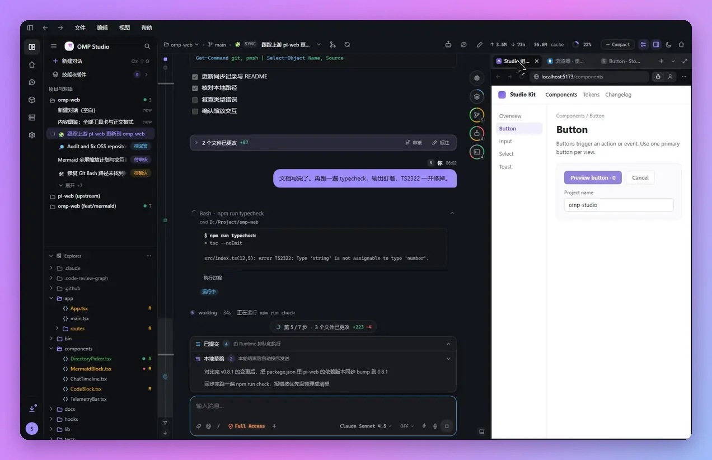
  <br>
  <sub>▲ 网页标签拖成浮窗后吸附到对话左侧，底栏的 OMP Logs 拖进右侧栏</sub>
</p>

<p align="center">
  <picture>
    <source media="(prefers-color-scheme: dark)" srcset="docs/readme/zones-dark.svg">
    
  </picture>
</p>

Files、Changes、Git、Browser、Computer、Agents、Terminal、Logs、BTW 等工具都能在 **左侧栏 · 对话工具区 · 右侧栏 · 底栏 · 浮窗** 之间移动。

- 移动超过 6px 就会显示**真实内容的落点预览**，松手才提交；不想拖动时，右键或 <kbd>Shift</kbd>+<kbd>F10</kbd> 打开菜单，同样可以移动、拆分、合并或隐藏。
- 右侧栏最多分**上下两组**，底栏最多分**左右两组**；浮窗内可以放多个标签。
- **对话也能停靠**：把对话窗口拖进右侧栏或底栏，就和工具一起作为标签显示。
- 折叠的卡片仍会显示摘要，例如 Git 的 `M / A / D` 计数和领先 / 落后，Changes 的文件数与 `+/-` 行数。

### 4 · 钉成独立窗口

浮窗的 Pin 菜单提供 **不固定 · 固定在工作区 · 固定在应用 · 独立窗口 · 独立窗口并置顶**。独立窗口在任务栏有自己的图标，可以拖到另一块显示器；重启后恢复仍然打开的窗口和位置。

<details>
<summary><b>⌨️ 快捷键速查</b>（点击展开）</summary>

<br>

| 操作 | Windows | macOS |
|---|---|---|
| 新建对话 | <kbd>Ctrl</kbd> <kbd>Shift</kbd> <kbd>O</kbd> | <kbd>⌘</kbd> <kbd>⇧</kbd> <kbd>O</kbd> |
| 收起 / 展开左栏 | <kbd>Ctrl</kbd> <kbd>B</kbd> | <kbd>⌘</kbd> <kbd>B</kbd> |
| 收起 / 展开底栏 | <kbd>Ctrl</kbd> <kbd>J</kbd> | <kbd>⌘</kbd> <kbd>J</kbd> |
| 在区域之间切换焦点 | <kbd>F6</kbd> / <kbd>Shift</kbd> <kbd>F6</kbd> | <kbd>F6</kbd> / <kbd>⇧</kbd> <kbd>F6</kbd> |
| 拖动时临时关闭吸附 | 按住 <kbd>Ctrl</kbd> | 按住 <kbd>⌘</kbd> |
| 标签 / 卡片菜单 | <kbd>Shift</kbd> <kbd>F10</kbd> 或菜单键 | — |
| 取消拖动或关闭菜单 | <kbd>Esc</kbd> | <kbd>Esc</kbd> |

隐藏的工具可以从 **视图 → 工具** 找回；首次使用教程可从 **帮助 → 使用教程** 重新打开。

</details>

<details>
<summary><b>🎬 首次启动教程</b>：8 段动画讲清新工作台</summary>

<br>

<p align="center">
  <picture>
    <source media="(prefers-color-scheme: dark)" srcset="docs/readme/tour-dark.webp">
    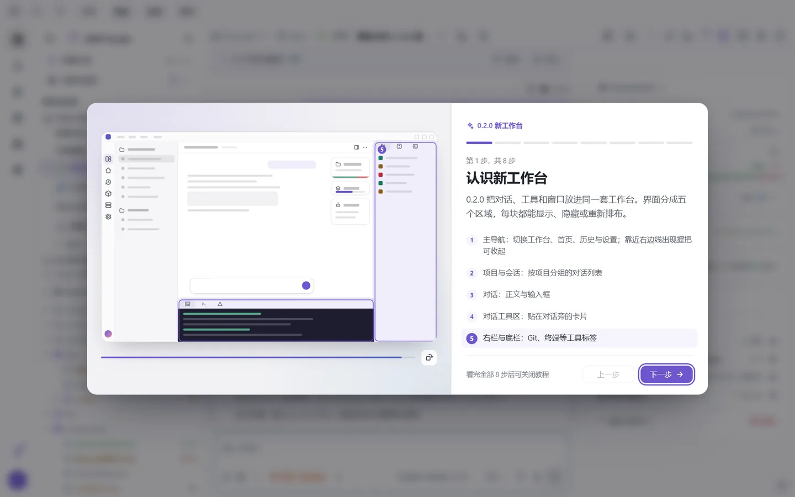
  </picture>
</p>

首次进入 0.2.0 时，教程用 8 段低保真动画演示工作台布局、拖出对话窗口、吸附分屏、停靠工具、标签与窗口互相拖放、对话工具区、独立窗口和常用快捷键。

</details>

更多规则见 [工作台停靠与布局](docs/workbench-docking.md)。

<br>

<a id="能力全景"></a>

## 能力全景

<table>
<tr>
<td width="50%" valign="top">
<picture>
  <source media="(prefers-color-scheme: dark)" srcset="docs/readme/home-dark.webp">
  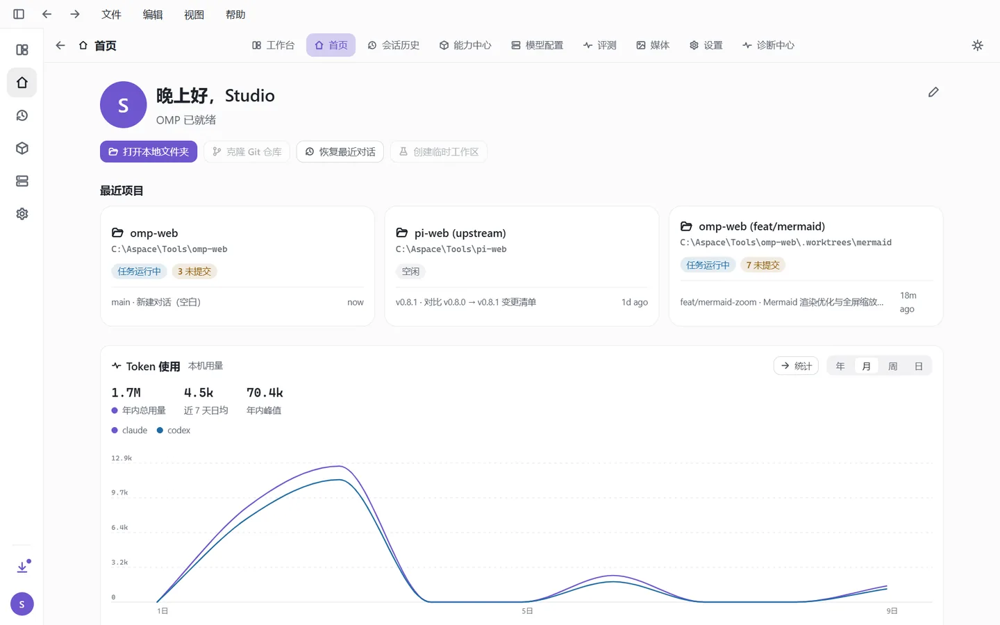
</picture>
<h3>📊 首页与用量</h3>
最近项目一键回到工作台；Token 折线图和热力图可按年、月、周、日切换。对话顶栏可随时展开本轮用量、缓存命中和上下文占用。
</td>
<td width="50%" valign="top">
<picture>
  <source media="(prefers-color-scheme: dark)" srcset="docs/readme/history-dark.webp">
  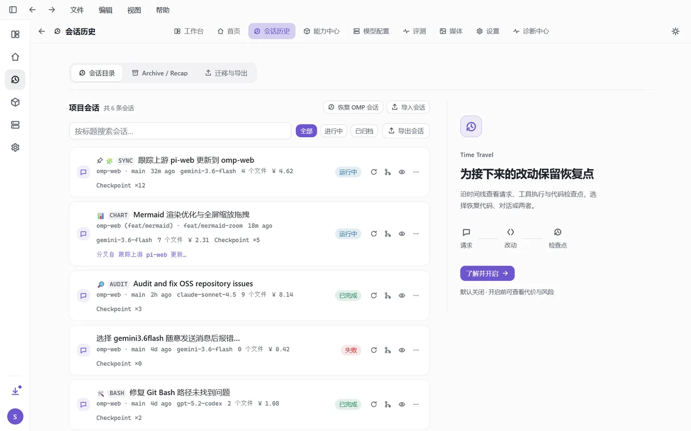
</picture>
<h3>⏪ 会话历史 · Time Travel</h3>
按回合保存工作区快照，预览文件变化后，可以只恢复代码、只恢复对话或两者都恢复，恢复前会留下备份。此功能默认关闭。详见 <a href="docs/time-travel.md">Time Travel</a>。
</td>
</tr>
<tr>
<td valign="top">
<picture>
  <source media="(prefers-color-scheme: dark)" srcset="docs/readme/agent-hub-dark.webp">
  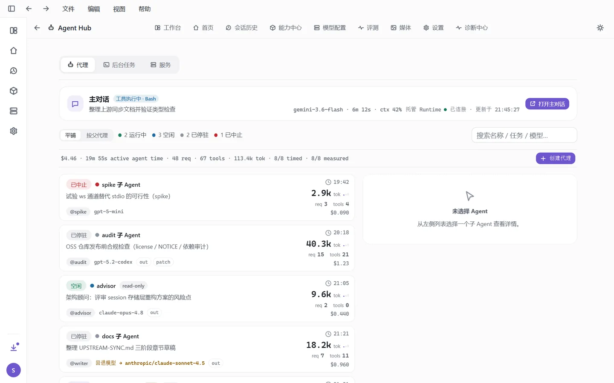
</picture>
<h3>🤖 Agent Hub</h3>
集中查看主对话和全部子 Agent 的状态、请求数、Token 用量和花费；支持 worker 子 Agent、任务文件和按子代理设置账号策略。
</td>
<td valign="top">
<picture>
  <source media="(prefers-color-scheme: dark)" srcset="docs/readme/model-config-dark.webp">
  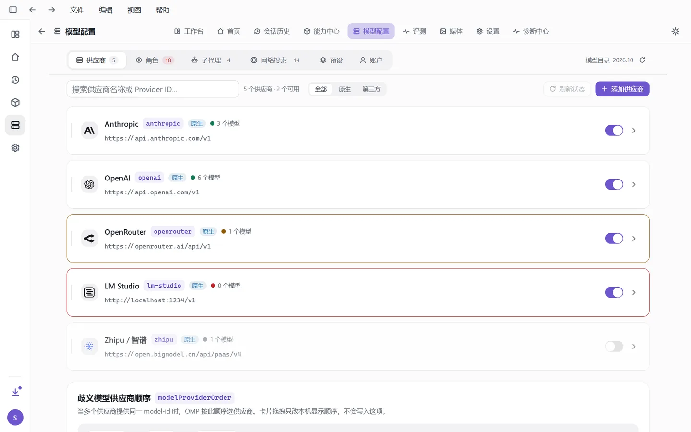
</picture>
<h3>🧠 统一模型配置</h3>
Anthropic、OpenAI、OpenRouter、本地 LM Studio 等供应商在同一页管理开关、端点和 <code>modelProviderOrder</code>；在角色页为 <code>@default</code>、<code>@plan</code>、<code>@task</code> 分别指定模型和思考强度。
</td>
</tr>
<tr>
<td valign="top">
<picture>
  <source media="(prefers-color-scheme: dark)" srcset="docs/readme/capabilities-dark.webp">
  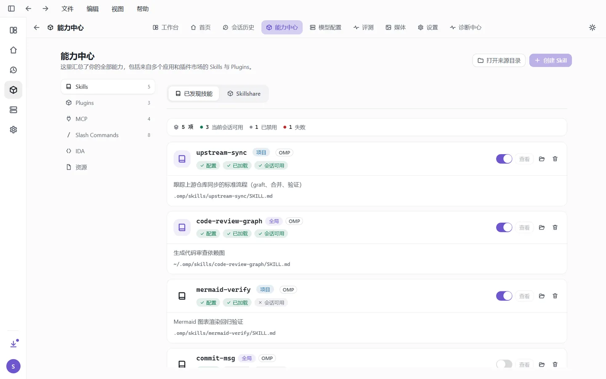
</picture>
<h3>🧩 能力中心</h3>
在同一页开关和探测 Skills、Plugins、MCP 与 Slash Commands，也可以直接打开所在目录；侧栏点击「加入」即可把 Skill 放进当前草稿。
</td>
<td valign="top">
<picture>
  <source media="(prefers-color-scheme: dark)" srcset="docs/readme/settings-dark.webp">
  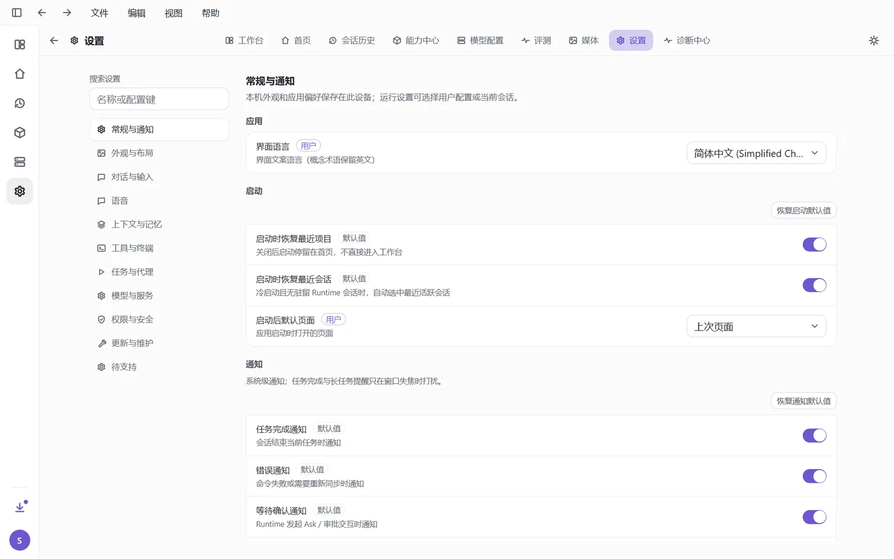
</picture>
<h3>⚙️ 设置与更新</h3>
设置分类清楚，并支持搜索；Runtime 配置按全局、项目和会话分层保存。应用内更新会验证签名，可选组件按需安装。详见 <a href="docs/settings.md">设置说明</a>。
</td>
</tr>
</table>

<details>
<summary><b>🔭 还有这些</b>：浏览器、电脑操作、Git、文件查看、SSH、评测、语音……（点击展开）</summary>

<br>

| 能力 | 说明 | 文档 |
|---|---|---|
| 🌐 **聊天浏览器** | 原生网页、多标签、人工与 Agent 控制交接、DevTools、元素截图引用、持久登录空间，并接入原生 WebMCP | [browser.md](docs/browser.md) |
| 🖥️ **电脑操作** | 动作与截图联动、历史画面、按会话停止和显式继续、只读界面结构 | [computer-use.md](docs/computer-use.md) |
| 🌿 **Git / Changes** | 暂存、diff、提交、Fetch / Pull / Push、提交图和 Worktree；Changes 按回合列出文件变化 | [feature-index](doc/feature-index.md) |
| 📄 **文件查看器** | 文本编辑、Markdown、PDF、图片、音视频、Excel / CSV；Word / PPT 通过可选组件打开 | [file-viewer.md](docs/file-viewer.md) |
| 🔐 **SSH 工作区** | 在本机或远端工作，支持系统密钥和账号密码，远端 Runtime 可有限恢复（开发预览） | [ssh-workspaces.md](docs/ssh-workspaces.md) |
| 💬 **BTW 旁路追问** | 不打断主线程地追问；支持图片、分支和子代理复用 | [btw.md](docs/btw.md) |
| 🎙️ **语音输入** | 点击或按住空格听写，内容插入到光标位置；失败后可从内存恢复录音 | [dictation.md](docs/dictation.md) |
| 📏 **评测工作区** | 原生基准、指令遵循评测、后台执行、历史对比，以及 Ratchet 最佳版本差异导出 | [evaluation.md](docs/evaluation.md) |
| 🧾 **对话细节** | 工具卡片、Plan / Vibe / 审批、排队与中途回复、Shell 回放、提示缓存状态和最多四条输入预测 | [omp-18.18.0](docs/migrations/omp-18.18.0.md) |

</details>

<br>

<a id="下载安装"></a>

## 下载安装

| 平台 | 安装包 | 说明 |
|---|---|---|
| **Windows x64** | `OMP-Studio-Setup-<版本>-windows-x64.exe` | 安装器，支持应用内更新 |
| **Windows ARM64** | `OMP-Studio-Setup-<版本>-windows-arm64.exe` | 骁龙等 ARM 设备 |
| **macOS Apple Silicon** | `OMP-Studio-<版本>-macos-arm64.dmg` | macOS 13+；ad hoc 签名，尚未公证 |

👉 前往 **[GitHub Releases](https://github.com/the-snowpear/omp-studio/releases)** 下载。具体文件名以 Release 页为准。Runtime 与更新目录使用 Ed25519 签名；Windows 安装包没有 Authenticode 签名。

<details>
<summary><b>🍎 macOS 首次打开被拦截？</b></summary>

<br>

打开 dmg，把 OMP Studio 拖进「应用程序」。当前预览版是 ad hoc 签名，尚未公证，首次打开会被 Gatekeeper 拦截。处理方法任选其一：

- 打开「系统设置 › 隐私与安全性」，点「仍要打开」；
- 或在终端执行：

```bash
xattr -dr com.apple.quarantine "/Applications/OMP Studio.app"
```

也可以按 [getting-started](docs/getting-started.md) 从源码运行，或用 `npm run pack:mac` 自行打包。

</details>

> [!TIP]
> 模型与登录沿用 OMP 的 `models.yml` / `omp login`。**本仓库不内置任何供应商密钥。**

<br>

<a id="从源码运行"></a>

## 从源码运行

<p align="center">
  <picture>
    <source media="(prefers-color-scheme: dark)" srcset="docs/readme/quickstart-dark.svg">
    
  </picture>
</p>

需要 **Node.js 22+**、Git 和 [Bun](https://bun.sh)。

```bash
git clone --recurse-submodules https://github.com/the-snowpear/omp-studio.git
cd omp-studio
npm install
npm run omp:overlay:apply
npm run preview
```

Windows 也可以直接双击仓库根目录的 `preview.cmd`；macOS 需要先安装 Xcode Command Line Tools。

Linux 已接入源码预览，环境准备与沙箱配置见 [Linux 客户端说明](docs/linux.md)。目前没有 Linux 桌面安装包；Release 中的 Linux remote 压缩包用于 SSH Host。

<details>
<summary><b>🔌 接上真实的托管 Runtime</b>（首次较慢）</summary>

<br>

```bash
npm run omp:install-deps     # MSVC Build Tools + Rust（macOS：检查 Xcode CLT / rustup / Bun）
npm run omp:overlay:apply    # 把 overlay 铺进 vendor 并套用接缝补丁（幂等）
npm run omp:keys             # 每台机器一次，生成本地签名密钥
npm run omp:build:host       # 构建 omp --mode studio-host
npm run preview
```

完整步骤与故障排查见 [docs/getting-started.md](docs/getting-started.md)。

</details>

<details>
<summary><b>🧪 开发者常用命令</b></summary>

<br>

| 命令 | 用途 |
|---|---|
| `npm run check` | 架构约束、选择器规则、编译、核心包和渲染层测试 |
| `npm run check -- --fast` | 只跑架构约束、选择器规则和编译 |
| `npm run check -- --only renderer` | 只编译渲染层依赖，再跑核心渲染测试 |
| `npm run check -- --production` | 追加 Vite 生产包和远端 Host 产物检查（CI 使用） |
| `启动预览.cmd` / `启动预览版.cmd` | 开发预览，分别使用真实 Host 数据和演示数据 |
| `npm run omp:patches:regen` | 改完 vendor 后回收 overlay 并重写接缝补丁 |

开发循环、预览模式和补丁 regen 见 [docs/development.md](docs/development.md)；改功能前先查 [doc/feature-index.md](doc/feature-index.md)。

</details>

<br>

<a id="架构"></a>

## 架构

<p align="center">
  <picture>
    <source media="(prefers-color-scheme: dark)" srcset="docs/readme/architecture-dark.svg">
    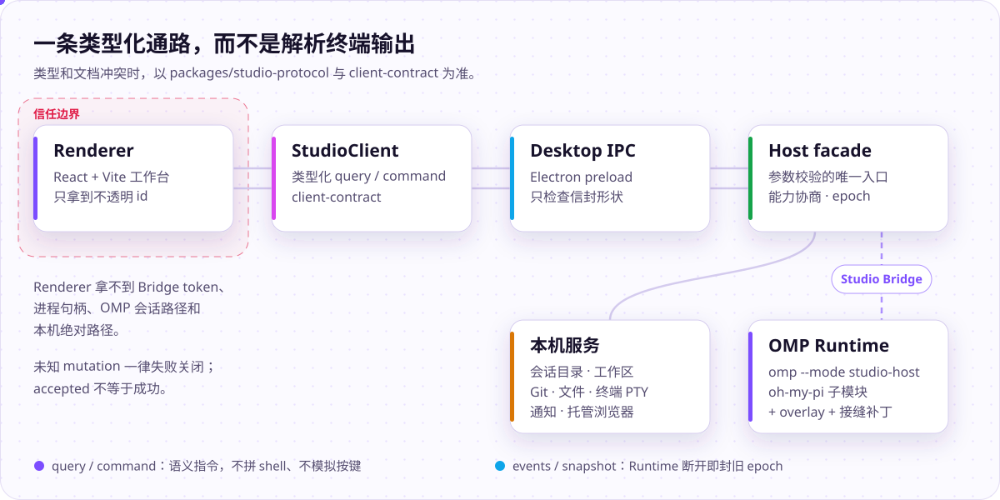
  </picture>
</p>

**不变量**（详见 [docs/architecture.md](docs/architecture.md)）：

- 类型与文档冲突时，以 `packages/studio-protocol` 和 `client-contract` 为准。
- Renderer 拿不到 Bridge token、进程句柄或 OMP 会话路径，只看到不透明 id。
- 未知 mutation 一律失败关闭；`accepted` 不代表成功。
- Runtime 断开后封存旧 epoch，未完成的请求标记为 `outcome_unknown`。

<details>
<summary><b>🗂️ 仓库结构</b></summary>

<br>

```text
apps/desktop          Electron 主进程；平台差异集中在 src/platform/
apps/renderer         Vite + React 工作台
packages/             协议、Host、客户端、传输、平台、测试工具
omp-patch/overlay     Studio 自有的 Runtime 源码（上游不存在的路径）
omp-patch/patches     对上游文件的接缝补丁，按子系统分四组（不要手改）
omp-patch/vendor      oh-my-pi 子模块（只提交 gitlink）
packaging/            Windows NSIS 安装器；macOS 签名配置
docs/                 使用与开发文档
```

</details>

<details>
<summary><b>🧬 Runtime 是怎么维护的？</b></summary>

<br>

Runtime 钉在 oh-my-pi 子模块上，Studio 的改动分两层：

- **overlay**：Studio 自有文件，上游没有这些路径，按普通源码编辑，升级上游时不会冲突；
- **接缝补丁**：只包含对上游已有文件的改动，按上游子系统分成四组，统一用 `npm run omp:patches:regen` 生成。

托管 Runtime 以 `omp --mode studio-host` 启动，产物使用 Ed25519 校验。详见 [omp-patch/README.md](omp-patch/README.md)。

</details>

<br>

## 常见问题

<details>
<summary><b>它和 omp CLI 是什么关系？</b></summary>
<br>
OMP Studio 是 omp 的桌面外壳。模型、登录、Skills 和会话都沿用 OMP 自己的配置与格式；Studio 通过 Bridge 调用 Runtime 的语义能力，不包装终端。上游 OMP 的缺陷请提交到 <a href="https://github.com/can1357/oh-my-pi">can1357/oh-my-pi</a>。
</details>

<details>
<summary><b>支持哪些模型？需要我提供密钥吗？</b></summary>
<br>
支持 OMP 能连接的全部供应商，例如 Anthropic、OpenAI、OpenRouter、本地 LM Studio 等。密钥和登录走 OMP 的 <code>models.yml</code> / <code>omp login</code>，本仓库不内置任何密钥。
</details>

<details>
<summary><b>截图里的数据是真的吗？</b></summary>
<br>
不是。README 中的截图和动画都在预览模式下录制，使用的是演示数据；实际使用时，界面只显示 Host 和本机返回的真实数据。
</details>

<details>
<summary><b>出问题了去哪看日志？</b></summary>
<br>
Host 诊断日志在 <code>%APPDATA%\omp-studio\logs\host-YYYY-MM-DD.log</code>，macOS 在 <code>~/Library/Application Support/omp-studio/logs/</code>。应用内的「诊断中心」也可以查看。反馈问题请提交 <a href="https://github.com/the-snowpear/omp-studio/issues">Issue</a>。
</details>

<br>

## 文档

| 入门 | 功能 | 开发 |
|---|---|---|
| [从源码运行](docs/getting-started.md) | [工作台停靠与布局](docs/workbench-docking.md) | [开发循环](docs/development.md) |
| [设置说明](docs/settings.md) | [Time Travel](docs/time-travel.md) | [架构与不变量](docs/architecture.md) |
| [应用内更新](docs/updates.md) | [聊天浏览器](docs/browser.md) · [电脑操作](docs/computer-use.md) | [功能 → 文件索引](doc/feature-index.md) |
| [更新日志](CHANGELOG.md) | [SSH 工作区](docs/ssh-workspaces.md) · [文件查看器](docs/file-viewer.md) | [overlay / 接缝补丁](omp-patch/README.md) |
| [全部文档](docs/README.md) | [BTW](docs/btw.md) · [语音输入](docs/dictation.md) · [评测](docs/evaluation.md) | [发布流程](docs/releasing.md) |

## 参与贡献

欢迎提交 Issue 与 PR。开始前请先阅读 [CONTRIBUTING.md](CONTRIBUTING.md) 和 [CODE_OF_CONDUCT.md](CODE_OF_CONDUCT.md)。**安全问题请不要发到公开 Issue**，按 [SECURITY.md](SECURITY.md) 私下报告。

中文交流、建议与反馈欢迎来 [LINUX DO](https://linux.do/) 社区，感谢佬友们的支持。

## 许可证

[MIT](LICENSE)。第三方声明见 [NOTICE](NOTICE)。钉住的 Runtime 来自 [oh-my-pi](https://github.com/can1357/oh-my-pi)（MIT；Pi by Mario Zechner，omp by Can Bölük）。Studio 的 overlay 和接缝补丁是本仓库的独立工作，同样以 MIT 授权。

<p align="center">
  <a href="#top">
    <picture>
      <source media="(prefers-color-scheme: dark)" srcset="docs/readme/footer-dark.svg">
      
    </picture>
  </a>
</p>
