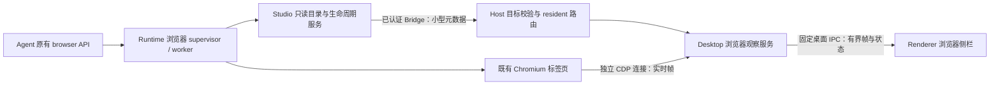

# 浏览器侧栏实时观看接入计划

日期：2026-09-23。状态：方案已整理，尚未实施或完成浏览器兼容性实测。

目标是在 OMP Studio 右侧直接观看 agent 正在操作的同一浏览器标签页，保留 Runtime 现有浏览器工具、执行方式与资源生命周期。实现依据 OMP 自身源码及 Chromium 协议，独立编写，不复制、移植或改写 zcode 源代码。

## 1. 已确认的范围

| 项目 | 已确认决定 |
|---|---|
| 接入方式 | 显示 Runtime 现有浏览器的实时画面，不另建一份网页 |
| 第一版交互 | 仅观看；允许选择观看哪个标签页、显示状态、展开和收起 |
| 侧栏入口 | 用“浏览器”替换现有 Preview 标签 |
| Runtime | 保留 browser 工具及 browser.open / tab.run 等原有调用方式，避免重做后端 |
| 后续能力 | 为元素选择、备注和上下文附件留边界，本次不实现 |
| 执行方式 | 单人顺序实施，不使用子代理 |
| 代码来源 | 不复用 zcode 代码；也不以改名或改写方式规避其许可 |

本版不提供地址栏导航、刷新网页、后退、点击、输入、滚轮转发、登录接管、选中文字、关闭真实标签页、录屏或浏览器历史回放。“重新连接画面”只重连观察连接，不刷新网页、不恢复会话、不重新启动 Runtime。

全局“预览模式”开关保持原义：开启时使用带“演示”标记的本地 fixture，关闭时只显示真实浏览器数据或诚实空态。被替换的是侧栏 Preview 标签，不是全局预览模式。

## 2. 源码基线与接入依据

核对时 Studio HEAD 为 `2a530c4ee3b7c9723f00e00d85c184de953d80b2`，分支为 `perf/streaming-rebuild`；OMP pin 为 `37273117021129e96bd05d8277b140ec3fd61990`（v18.2.5）。工作区另有正在进行的性能改动，实施时以最新源码重新定位；不能覆盖这些改动。

| 当前事实 | 源码位置 | 对方案的影响 |
|---|---|---|
| 浏览器工具把调用方 session ID 传给 acquireTab | `omp-patch/vendor/oh-my-pi/packages/coding-agent/src/tools/browser.ts` | 不从对话正文或工具日志猜归属 |
| supervisor 保存 targetId、ownerSessionId、kindTag、pending、persist、lastActivityAt、frozen | `.../tools/browser/tab-supervisor.ts` | 可增加小型只读导出和生命周期通知，无需改 tab.run 的执行协议 |
| 标签名在进程内复用，创建者归属不会因其他调用方复用而转移 | 同上，`acquireTabImpl` | tab name 不能单独充当 GUI 身份；创建者与当前操作者要区分 |
| Puppeteer handle 已持有 browser.wsEndpoint；worker 初始化也使用该端点与 targetId | `.../tools/browser/registry.ts`、`tab-supervisor.ts` | Desktop 可独立附加到已有目标；无需另起浏览器或更换启动参数 |
| 自有 Chromium 可能由共享 daemon 提供 | `.../tools/browser/shared-daemon.ts` | 同一浏览器进程不等于同一 OMP 会话，必须使用 Runtime 授权的目标集合 |
| headless 自有页受 settle-freeze / idle-close 管理；persist、外接页等规则不同 | `tab-supervisor.ts`、`.../session/agent-session.ts` | 观看不能续命、解冻、改变 persist 或 lastActivityAt |
| Bridge 的大部分请求先调用 ensureWorkerLive | `omp-patch/overlay/packages/coding-agent/src/studio/bridge-dispatcher.ts` | 新只读查询必须在该调用之前分流，否则观看会唤醒或延长 Worker 生命周期 |
| 长时间 core.prompt 占用正常 dispatch 队列，读取有独立并发白名单 | `.../studio/bridge-server.ts` | 浏览器元数据查询加入只读并发通道，不等 agent 回合结束 |
| Host 支持多个 resident Runtime，各自绑定 session 和 workspace | `apps/desktop/src/runtime-session.ts` | 根据明确目标定位 resident，不能只取 activeComposition 的当前 session |
| 已有固定的桌面专属 IPC / preload 模式 | `apps/desktop/src/terminal-shared.ts`、`terminal-ipc.ts`、`preload.ts` | 可按同类方式增加窄浏览器观察 API，不扩展通用 invoke |
| Preview 真值面目前是 Deferred，侧栏布局记忆包含 preview | `apps/renderer/src/App.tsx`、`settings/appSettings.ts` | 替换标签与内容，并迁移布局记忆、命令面板、翻译和测试 |
| Renderer 禁用 webview，CSP 限制外部连接 | `apps/desktop/src/security.ts` | 本方案不需要 webview、iframe 或 Renderer 直接连接 CDP |

表中 `.../tools`、`.../session` 均相对 `omp-patch/vendor/oh-my-pi/packages/coding-agent/src/`；`.../studio` 相对 overlay 的同级 src。

## 3. 架构与职责



Runtime 仍唯一负责 agent 的浏览器调用、导航、截图、关闭、冻结和回收。Desktop 只持有可撤销的观察连接；侧栏显示的就是原 target 的画面。

图像不经过模型、不加入消息或工具结果，不进入 conversation Store、全局 reducer、Host ledger、telemetry 数据库或会话归档。工具原有截图及输出完全保留。Bridge 只增加低频目录/生命周期信息，不承载图像。

桌面观察 API 与现有 Host `bootstrap/query/command/subscribe/event/close` 通道分开。新增的是固定、类型化的桌面媒体观察接口；不在 `client-contract` 增加 browser click/evaluate 等能力，也不假装这是远端 Web UI 已支持的能力。

### 3.1 第一版后端覆盖

| Runtime 后端 | 计划覆盖 |
|---|---|
| OMP 自有 headless Chromium，包括共享 daemon 下的自有 target | 第一版必验、必须可观看 |
| OMP 自有可见 Chromium（headless: false） | 使用同一适配器；通过不抢焦点等测试后标记可观看 |
| connected / spawned / relay | 原有 Runtime 操作照常保留；首版不承诺侧栏支持，返回具体原因，不扫描或自动接管外部页面 |
| cmux | 首版不提供画面；保留后端类型，显示不支持 |
| 未驻留历史会话、未知归属、独立进程子代理 | 不为观看启动/恢复会话；没有可验证的目标通道就显示不可观看 |

以上是控制首版改动面的实现建议。扩展到外部浏览器应单独验收连接、归属、权限与多调试客户端行为，不能因它也使用 CDP 就自动放行。

### 3.2 先验证的技术前提

采用单独 CDP WebSocket，按明确 targetId 调用 `Target.attachToTarget`，使用返回的扁平 session。只启动该 session 的 Page 观察，不使用 Puppeteer 的全浏览器自动附加、Target.setAutoAttach 或无差别目标发现。

独立 CDP session 不是服务端只读权限，也不构成“完全不会影响另一个客户端”的保证。只读限制由 Desktop 适配器的固定命令集合实现，并通过阶段 B0 的实测验证。若会影响 Runtime 原有操作，不能以隐藏的页面激活、视口覆盖或暂停 agent 来掩盖；保留默认关闭并报告结果，重新讨论接入路线。

## 4. Runtime 最小接缝

### 4.1 supervisor 只读观察点

在上游 `tools/browser/tab-supervisor.ts` 中增加窄的只读目录导出与订阅钩子，Studio 服务置于 overlay。不能从正式服务调用 `getTabsMapForTest`，也不能把可变 TabSession、Browser、Page、worker 或 pending Map 暴露给外层。

导出字段限制为：标签的稳定实例身份、名字、ownerSessionId、后端种类、targetId、私有端点、生命周期、是否忙碌、最近已知标题/URL/视口及其新鲜度。端点只进入 Host/Desktop 私有 DTO；不记录到日志或持久化。

事件覆盖创建完成、复用/运行开始与结束、冻结/解冻完成、关闭开始/完成、异常死亡、worker 回收成功/失败。钩子只发布小型快照或失效通知；不可等待 GUI，不抛错打断工具，subscriber 移除后不保留标签资源引用。

实例代次由新的标签实例或连接替换推进；同名 close→open 必须获得新身份。worker 在同一个 target 上 recycle 时也推进观察代次并重新确认连接，防止迟到帧被当成新状态。

`ReadyInfo` 主要来自初始化，不能声称它的 URL、标题、viewport 永远实时。可标记为最近已知值；观看中的准确标题/URL/视口由 Desktop 对获准 target 的 CDP 元数据更新。未知值不补假值，不靠解析 tab.run 返回文本更新。

### 4.2 Studio 私有读取与失效事件

建议内部 operation 为 `browser.observer.describe`，低频失效事件为 `browser.observer.changed`；名称在实施前统一进协议类型、验证器、能力清单与契约测试。这些是 Bridge 内部观察能力，不是新增 LLM browser 工具。

describe 必须满足：

1. 在 `ensureWorkerLive` 之前处理，只读现存 registry / worker residency；不创建 Session、不调用 acquireBrowser / acquireTab。
2. 加入 Bridge 并发读取白名单，不进入 mutation arbiter、幂等写回放或命令 ledger。
3. 检查 runtime epoch、目标 session / 可验证子代理关系，并返回读取期间的目录 revision；Host 在返回前再次核对 resident 绑定。
4. 目录限制最多 64 项、总响应最多 256 KiB，包含明确的 `truncated` 状态；该限额不限制 Runtime 自己能开多少标签。
5. 没有观察支持、Worker 休眠、归属未知时返回明确状态，不借机唤醒或修复 Runtime。

changed 只含作用域、目录 revision 和有限生命周期信息，不含图像/端点。按目录实际变化合并，最多每 100ms 一次；清理本地观察资格无需等待合并计时器。

事件仍由现有 projector 分配 runtime-wide eventSeq。Host 先按原有规则处理序号，再在私有浏览器订阅处分发；不能在序号校验前过滤事件，也不能让它触发无变化的全局 snapshot 重投影。Bridge 重连/断档后执行一次 describe 重建观察目录，不要求把目录塞进 OperatorStateSnapshot。

新 Runtime 面向不支持此事件的旧 Host 时必须停止发出该事件。最低限度使用显式 opt-in 的 describe 建立当前已认证连接的目录订阅，断开即清除；新 Host 则先检查浏览器观察 capability 再调用。能力缺失时保留原有对话功能，侧栏提示需要支持该功能的 Runtime。不能向旧版严格解析器主动发送新 kind。

### 4.3 会话与子代理归属

内部身份至少区分 workspaceId、runtimeInstanceId、runtimeEpoch、workerGeneration、ownerSessionId、tabId、tabGeneration。Desktop 再创建只对当前窗口有效的观察 ID。标签名、URL 和裸 targetId 都不能单独作为身份。

主会话只展示属于它的标签，以及 Runtime/Agent Hub 明确证明属于其子代理的标签。同进程子代理复用父标签时，创建者归属保持不变；可以用运行钩子的调用方 session 标注“正在被子代理使用”，但不转移标签所有权。无法确定活动调用方时只显示“操作中”。

独立 Runtime / 隔离进程的子代理不能靠全局 target 扫描补齐；首版不扩建跨进程浏览器传输。后续仍可复用同一目标 DTO 增加受认证来源。

## 5. Desktop 观察服务

### 5.1 目标解析与能力边界

增加注入式 BrowserObservationManager：Electron 接口、CDP 连接工厂、时钟与 resident 解析器均可替换，方便单测。由 host-composition / host-factory 注入私有读取端口，runtime-session 根据明确 workspace + session 找已存在且绑定匹配的 resident；该读取不调用 ensure/resume、不改变 activeSessionId。

Main 只使用已认证 Runtime 返回且经过后端策略验证的 CDP 地址。首版仅允许自有 Chromium 的 loopback ws 端点，校验协议、主机和端口；拒绝 Renderer 传入的地址、端口、CDP 方法、脚本或任意 targetId。共享 daemon 的端点即便相同，也只允许附加到本次目录授权的目标。

固定 CDP 集合围绕 target attach/detach、目标信息、Page enable/disable、帧起停/确认、必要的只读布局查询展开。禁止导航、reload、输入派发、执行脚本、setDeviceMetricsOverride、bringToFront、activateTarget、setWebLifecycleState、Browser.close、Target.closeTarget。首版也不注入“只读”的 DOM 选择脚本。

只对当前正在观看的一个 target 建立图像连接，不为所有 resident、所有标签长期维持 CDP 或捕获。目录监听只消费低频元数据。

### 5.2 画面链路与两级确认

主路径使用 Page.startScreencast → Page.screencastFrame → Page.screencastFrameAck，退出时 stopScreencast 并 detach 自己的 session、关闭自己的 WebSocket。

本地随依赖提供的协议定义只有 format / quality / maxWidth / maxHeight / everyNthFrame，没有 fps 参数。2026-09-23 在线核对的官方 master 另有 maxFramesInFlight / sendLastFrame，不能推断当前 Runtime 所用 Chromium 支持它们。因此首版使用本地版本已知参数，产品限帧与背压自行实现，扩展参数经能力探测和实测后才能使用。[官方协议源](https://github.com/ChromeDevTools/devtools-protocol/blob/master/json/browser_protocol.json)

CDP attach 的 sessionId、screencastFrame 内用于确认帧的整数 sessionId、OMP sessionId 必须在代码中使用不同字段名。主进程收到帧先检查当前观察代次，再决定替换、发送或丢弃，并对本 session 收到的帧做有界确认；不能只确认真正渲染的帧。

两级流控分别处理：

- CDP→Main：只留最新候选帧，限制 WebSocket 消息、JSON 解析输入、压缩字节和像素尺寸；对不显示的有效帧也确认。帧洪泛或协议异常时停止该观察，不无限接收后再只在 React 层丢弃。
- Main→Renderer：一个未确认帧加一个最新候选帧。Renderer 在解码/绘制完成或明确丢弃后返回固定 ack，Main 才发送下一帧。Renderer 卡住时停止推送；不能每帧无条件 webContents.send 造成 Electron 内部排队。

startScreencast 属实验协议，侧栏可用性取决于目标实际支持及合成状态。静止页面没有连续新帧很正常；不能仅凭“数秒没帧”判断线。网络断开、target 销毁、协议错误、超时请求分别处理；冻住的页面保留标注过的最后一帧，不解冻它来制造动效。

首次附加没有首帧时，最多尝试一次同 target 的可视区域 captureScreenshot，标记为静态画面，并仅在阶段 B0 已验证不激活、不改变视口时启用。禁止轮询截图来伪装稳定实时流；不自动切換远程桌面、WebRTC 或另起浏览器。

### 5.3 初始资源预算

下表是待实现的初始上限，不是已测出的性能结论。阶段 B0 记录实测，调整预算必须有说明。

| 对象 | 初始预算 |
|---|---|
| 实时图像流 | 整个桌面最多 1 条，仅当前窗口当前选中标签 |
| 输出尺寸与质量 | 目标最大 1280×720，JPEG quality 65；只缩小输出图像，不改网页 viewport |
| 帧输出 | Main→Renderer 最多 10fps；不是对 Chromium 源帧率的承诺 |
| 压缩帧 | 最多 2 MiB；解码尺寸最多 4096×4096 且总像素最多 4,000,000 |
| CDP WebSocket 消息 | 最多 4 MiB，尽量在完整 JSON 解析前限制；超限断开观察 |
| 图像队列 | Main 一个未确认帧 + 一个最新候选；Renderer 一个解码中任务 + 一个最新候选 |
| 解码资源 | 最多当前显示与替换中的两张位图；过期位图立即 close |
| 帧确认超时 | 2 秒停止图像流并清理；面板仍可显示状态 |
| CDP 请求 | 最多 8 个在途，每项 3 秒超时；dispose 统一取消 |
| 自动重连 | 有资格且可见时按 0.5 / 1 / 2 秒最多 3 次；重新 resolve 目标，成功稳定后重置 |
| 观察租约 | 可见时每 5 秒续约，15 秒无续约即清理；窗口销毁/导航/隐藏不等租约 |
| 目录 | 每 resident 最多投影 64 项、256 KiB；Renderer 只订阅当前查看作用域 |

输出限速不能消除 Chromium 编码开销。需在 B0 比较 everyNthFrame 不同取值下的编码开销、时延和末帧行为；没有可接受组合就暂停启用，不能声称仅靠丢帧解决所有性能问题。

### 5.4 固定 IPC / preload

建议 `window.ompStudioBrowser` 提供 observe、setView、ackFrame、unobserve，以及 onCatalog / onStatus / onFrame。方法使用固定通道和严格 DTO，不提供 sendCommand / evaluate / invoke。

observe 绑定当前受信窗口和请求中的 workspace/session 作用域，返回新 observationId 与目录快照；setView 表达面板可见性和选择的 opaque tabId，ackFrame 仅确认当前 streamGeneration 的已发序号。具体目标身份和 epoch 由 Main 解析校验，Renderer 提供的值不能成为授权来源。

订阅先于请求安装，返回 observationId 前不启动帧推送；setView 同时作为明确的开始消费信号。目录事件带 revision，连接建立期间合并至最新快照，避免快照与后续事件竞态。

所有输入做 exact-key、类型、数量、长度和代次验证，校验 sender 与 main frame；观察 ID 与窗口绑定，不能跨窗口复用。导航、销毁、工作区变化、会话切换、预览模式开启、最小化、托盘隐藏、页面不可见、失去租约均取消图像流。Main 监听窗口状态，不能完全信任 Renderer 自报可见性。

只读观看得到的标题与 URL 当作不可信文本显示，不加载网页 favicon/远程资源，不把 URL 作为 renderer navigation。完整端点、认证信息、图像 base64、页面正文不进诊断日志；诊断仅记录计数、状态和经过限制的错误码。

## 6. Renderer 与产品行为

### 6.1 侧栏入口

将 SideTab 的 `preview` 改为 `browser`，可见标签和 aria 名称用“浏览器”。更新 App、布局类型/解析/恢复、快捷动作、commandPaletteCatalog、相关 Preview fixture 和中英文文案。旧 localStorage 中 `sideTab: preview` 读取时迁移成 browser，新写入只用 browser；遇到未知值用现有安全默认值。

全局预览开关、首页预览、构建预览等其他同名功能不做全局字符串替换。现有侧栏 Preview 的演示 URL/日志壳由浏览器演示壳替换，不能留下两个互相竞争的入口。

### 6.2 观看交互

顶部为可滚动的标签列表和只读标题/地址，主体是按比例适配的实时画面，底部提供状态与必要的重连观察入口。用户选标签只是切换“看哪个页面”，不激活 Chromium 页、不改变 agent 后续 tab.run 的目标。

自动展示按以下规则实施：

- 当前查看会话首次出现可观看标签时，自动打开“浏览器”。后台会话的变化不能切换当前会话或抢侧栏。
- 用户本次会话手动关闭浏览器侧栏或切到其他标签后，后续浏览器活动只更新轻量提示，不反复抢回。手动重新打开可恢复观看。
- 默认跟随最近有明确运行活动的获准标签；用户手动选中某标签后保持选择，直到该标签关闭或用户选择恢复跟随。
- 多标签/多工具同时运行时采用确定性顺序，不以每一帧的到达顺序切换；没有活动真值时保持选择，不假定“最近 URL”是正在操作的页。
- 鼠标只操作侧栏自身的按钮，不转发页面输入。不绘制推测的鼠标轨迹或虚假的点击波纹。

### 6.3 状态与生命周期

| 情况 | 界面行为 | 资源行为 |
|---|---|---|
| 无桌面桥 / Web UI | “当前环境不支持浏览器实时观看” | 不连接 |
| Runtime 不支持观察 | 提示需要兼容 Runtime | 不调用未知 operation |
| 会话没有浏览器页 | 诚实空态，说明 agent 使用浏览器后可观看 | 仅当前作用域目录监听 |
| 正在连接 / 首帧未到 | 明确加载状态 | 有界超时，无轮询截图 |
| 实时观看 | 显示画面与实时状态 | 一条活跃流 |
| 页面静止 | 保持画面，不误报断开 | 等待事件 |
| Runtime 冻结页面 | 显示“页面已休眠，显示最后画面” | 停流，不解冻；无历史帧则用空态 |
| 侧栏收起 / 切到其他标签 / 窗口隐藏 | 停止观看 | 停流、detach、释放解码和待发帧 |
| Runtime 自行恢复同页 | 重新核对代次，面板可见才重连 | 不能由观察请求触发恢复 |
| target 关闭、回收或崩溃 | 清除该页画面，显示终态或选择下一个获准标签 | 立刻撤销对应观察资格 |
| 会话/工作区/Runtime 代次切换 | 先清旧画面，再载新目标 | 迟到回复、帧、ack 全部隔离 |
| 手动“重新连接画面” | 只重试观察 | 不调用 runtime.ensure、session.resume 或 page.reload |

### 6.4 画面渲染和后续坐标空间

使用独立 BrowserViewport 组件，通过 ref 管理 canvas 与 ImageBitmap；每帧不 setState、不触发 App / 对话区 React 提交。状态和目录只在低频实质变化时更新。解码失败、卸载、代次切换时关闭位图；RAF、timer 和事件监听均有清理点。

保留原始帧元数据、实际编码尺寸、CSS 显示矩形、留白、缩放比例及所属代次，集中到独立 viewportTransform 模块。现阶段仅用于正确显示和测试，不实现输入映射。画面缩放与网页 viewport 分离，拖宽侧栏不调用 page.setViewport。

CDP 帧元数据含 DIP 尺寸、pageScaleFactor、CSS 滚动偏移等，它们与画面像素不应直接等同；未来元素选择需要同时考虑 visual viewport、缩放、滚动、frame 导航和 DPR。不能仅保存一个缩放百分比就宣称后续可无缝点击。[官方 Page 定义](https://github.com/ChromeDevTools/devtools-protocol/blob/master/json/browser_protocol.json)

### 6.5 演示与真实两套数据

新增 `preview/browserPreview.ts`，优先复用现有 ver1 的页面故事、标题和状态；演示图来自项目内确定性的静态 fixture，不请求真实网站、不连接 Runtime、不启动浏览器。可以是简化的本地演示页面壳，无需生成图片或引入外部素材。

`usePreviewMode()` 为唯一开关。预览开启即断开真实浏览器观察，fixture 的选标签/连接状态按钮只改本地 UI，并常驻“演示”标记；关闭后清空演示状态，再建立真实订阅。两种模式都覆盖多标签、连接中、静态/休眠、关闭和不支持状态；不使用“空了回退 mock”。

## 7. 为元素选择和备注留出的边界

本次只交付有实际用途的目标身份、帧元数据、viewportTransform 和观察服务分层。元素选择/备注/人工输入在 capability 中明确为未实现，不挂空实现、不暴露通用 CDP 执行口。

后续可独立添加三部分：

1. **元素选择服务**：通过目标专属、受控 DOM 查询获取元素语义与包围盒。请求绑定 tabGeneration、文档导航版本、frame 身份与所见 frameSeq；画面过期或文档变化则拒绝并要求重选。跨源 iframe、shadow DOM、页面缩放另行验证。
2. **备注模型**：备注文本与位置/元素引用分离；标明绑定哪一帧/文档。用户备注存储、保留时长和截图权限单独设计，不能默认把网页内容写入会话。
3. **Composer 附件适配**：把经用户选择的元素摘要、备注和可选截图转成明确附件，复用现有 composer/types.ts、serialize.ts 等入口。仅在用户提交时进入上下文，不能自动把实时画面或所有 DOM 发给模型。

人工接管属于独立后续任务：需要真实的控制权仲裁、在途浏览器操作排空、输入法/键盘/坐标语义；暂停模型回合并不自动等于浏览器工具已停。该问题不能靠本版一个“只读=false”开关解决。

## 8. 顺序实施清单

所有路径是计划落点，未存在的文件在此阶段才创建。文件拆分可按最终类型大小调整，职责与验收不可省略。

| 阶段 | 主要落点 | 交付和完成条件 |
|---|---|---|
| B0 技术验证 | 新 `scripts/browser-observer-spike.mjs`、本地确定性测试页、测试报告 | 使用 Runtime 原有 browser 工具创建页，再以独立 CDP 观察；确认同页、控制不中断、不抢焦点、不改 viewport、冻结/回收正常；记录开/关观察的性能基线 |
| B1 Runtime 接缝与协议 | vendor `tools/browser/tab-supervisor.ts`；overlay 新 `services/browser-observation-service.ts`；studio-host-mode / bridge-dispatcher / bridge-server / bridge-protocol / state-projector；root studio-protocol contracts、validation、能力清单与导出 | 目录、代次、低频事件、旧版协商和不唤醒读路径；新接缝加入 omp-seam 后 regen；帧字节从未进入 Bridge |
| B2 Host 私有通道 | studio-host bridge-client / runtime-session-controller、私有观察 DTO/事件模块及导出；desktop runtime-session / host-composition / host-factory / 相关结构类型 | 严格匹配 resident 和 workspace/session；前后校验 epoch；断线与重连清目录；不改当前会话，不建 ledger 条目 |
| B3 Desktop 帧服务 | 新 `apps/desktop/src/browser-observer.ts`、`browser-cdp.ts`、`browser-shared.ts`、`browser-ipc.ts`；preload / main 组装 | 受限 CDP、代次屏障、两个 ack、队列预算、可见性/租约、资源释放和脱敏日志 |
| B4 Renderer 接入 | 新 `apps/renderer/src/browser/BrowserPane.tsx`、`BrowserViewport.tsx`、`useBrowserObservation.ts`、`viewportTransform.ts`、styles/browser.css；App、settings/appSettings、commandPaletteCatalog、i18n、vite-env、preview/browserPreview 与 surfaces | 替换 Preview；旧布局迁移；自动展开不抢后台；实时/演示双路径；所有观看控件只影响观察；帧不进 React 热更新 |
| B5 集成与发布验收 | 相关 test、脚本测试、`doc/feature-index.md`、使用说明；Runtime 打包元数据 | 原有 browser 回归、跨会话压力与资源测试；支持的新 Runtime 构建/制品可用；完整 check 与补丁验证；真实浏览器 smoke 后启用 |

建议先 B0，再按 B1→B2→B3→B4→B5 完成。B0 不通过时停止开启正式功能；不自动改用原生内嵌方案。实施期间通过桌面内部 feature flag 保持默认关闭，B5 通过后启用；它不是第二套预览模式开关。

### 8.1 备份与 Runtime 补丁流程

修改既有文件前，备份到 `backup/YYYY-MM-DD/browser-sidebar-阶段-HHmmss/`，保留相对路径，README 写来源提交、原因、清单和恢复步骤。B1 尤其要保存将编辑的 vendor 原文件、对应 overlay、scripts/omp-seam.mjs、series.json 及会被 regen 改写的接缝文件；不备份依赖、构建产物或机密。

新增上游接缝路径先登记到 `scripts/omp-seam.mjs` 的会话 Runtime 分组，再执行标准流程：

```bash
npm run omp:overlay:apply
# 在 vendor 中编辑和验证，Studio 自有服务由 overlay 管理
npm run omp:patches:regen
```

禁止手写 patch。regen 前后检查 diff，不回收或覆盖其他任务的 vendor 改动。更新 README / feature-index 时明确它是已交付功能还是设计文档，不能先把计划当作实现登记。

### 8.2 必须验证的场景

| 类别 | 验收用例 |
|---|---|
| 同页与工具兼容 | Runtime browser.open、tab.run 导航/填表/滚动/截图；观察显示同一 target 的确定性状态；原 API 参数、返回与截图行为不变 |
| 第二 CDP 客户端 | Runtime Puppeteer + observer 同时连接；开始/停止观察不 detach Runtime、不关闭 browser；截屏和操作并发正常 |
| 页面状态 | 静止、动画、导航、viewport 变化、100%/150%/200% Windows 缩放；调整侧栏不改变网页布局与 focus/visibility |
| 归属与竞态 | 两个会话共用 daemon、同名标签、同 URL、快速切会话、标签关闭重开、worker recycle、Runtime epoch 变化；不接受旧帧或跨会话 ack |
| 生命周期 | 关闭面板、切侧栏标签、切预览、最小化、关闭到托盘、窗口销毁、连接断开；无残留流/定时器/位图；不修改 lastActivityAt / persist / ownerSessionId |
| 冻结和休眠 | settle-freeze、idle-close 和主 Worker 休眠按原时机发生；describe 不调用 ensureWorkerLive；观察不使冻结页复活 |
| 背压与故障 | Renderer 不 ack、连续超大帧、错误尺寸、坏 base64、畸形消息、CDP 超时/洪泛；计数在预算内，观察失败不打断 agent |
| 版本兼容 | 新桌面+旧 Runtime 诚实不可用；旧 Host+新 Runtime 不收到未协商的新事件；重连后 describe 补目录；新类型的严格 round-trip 校验 |
| UI 规则 | 当前会话首次浏览器活动自动展示；后台不抢；手动切走不反复打开；旧 preview 布局迁移；全局预览切换不串真实帧 |
| 后端降级 | connected/relay/cmux/隔离子代理等显示明确原因，不偷偷起 Chromium 或扩展权限 |

性能验收用本机 Windows、相同生产构建、固定本地页面和固定对话回放，分别记录关闭观察与开启观察的工具耗时、输入延迟、Main/Renderer/Chromium CPU、RSS/external、帧时延、帧/字节/丢弃量。源帧频率与展示帧频率分别计数，不把没有页面变化误当掉帧。

硬性验收：活跃流/在途帧/位图/定时器不超过预算；关闭或销毁后观察资源归零；至少 100 次开关/切页/重连无逐轮增长；10 分钟连续动画和对话回放不形成积压。测试不强制 GC、不压工作集。工具功能正确且输入/滚动响应没有明显回退；具体性能门槛由 B0 实测基线记录后冻结，不能在没有基线时承诺提升比例。

建议按阶段跑相关包测试，最终执行：

```bash
npm run check
npm run runtime:verify-source
npm run omp:test:metadata
npm run omp:verify:patches
```

补丁验证按仓库要求在干净或隔离的 vendor 验证副本运行，不能破坏另一任务正在修改的 vendor。还需针对 vendor 的 browser-freeze-settle、browser-tab-timeouts、browser-run-cancellation、browser-lifecycle-leak、browser-open-lease、browser-attach 等已有测试及新增 studio-browser 测试执行 Bun 测试（每项采用项目约定 30 秒 timeout）。

最后构建兼容 Runtime 制品并用打包版 Electron 做实际 smoke，覆盖 headless、共享 daemon、最小化/托盘恢复。单测和开发服务器通过不等于打包交付完成。

## 9. 回退与完成定义

紧急回退先关闭桌面内部功能开关、清理观察连接并显示不可用状态；不关闭或更换 agent 的浏览器，不主动重启 Runtime。旧 Runtime 持续可用。撤回源码改动时只撤回本功能文件，按备份 README 和 git diff 核对，不覆盖其他性能优化。

功能完成需要 B0–B5 全部验收，并且用户能在“浏览器”侧栏看到 agent 的同一页面；原 browser 工具继续工作；收起后资源释放；会话隔离正确；预览/真实互斥；没有实现或暗中开启人工输入、元素选择或备注。

**本次计划编写完成的范围：**恢复原会话中已确认的决定、核对当前 OMP/Studio 源码、确定接入边界与顺序、记录兼容性风险和验收。尚未编写产品实现，未运行真实 CDP 双连接实验，未声称已经支持实时观看。

## 10. 依据与后续核对

- 功能入口与工作规则：[feature-index](feature-index.md)、[AGENTS.md](../AGENTS.md)。
- Runtime 管理边界：[omp-patch/README.md](../omp-patch/README.md)。
- 同分支性能约束：[streaming_rebuild.md](streaming_rebuild.md)。本方案不会改造既有 conversation 传输；新增图像流遵循独立消费、预算与清理原则。
- Chromium 命令和字段：[官方协议 JSON](https://github.com/ChromeDevTools/devtools-protocol/blob/master/json/browser_protocol.json)，2026-09-23 已读取；实施以实际启动的 Chromium 与本地依赖协议为准，不能直接依赖 master 新增参数。
- 本地协议字段：`omp-patch/vendor/oh-my-pi/node_modules/devtools-protocol/types/protocol.d.ts` 中 StartScreencastRequest、ScreencastFrameEvent、ScreencastFrameMetadata、AttachToTargetRequest。依赖目录仅用于核对，不复制进产品或备份。

本计划未复制 zcode 的源码、测试、注释或素材，不对第三方许可作法律结论。
