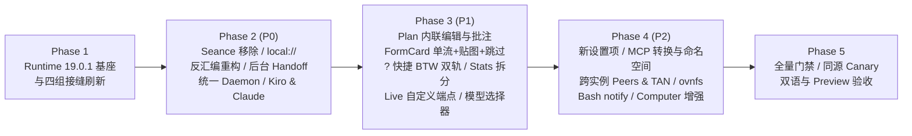

# OMP 18.20.2 → 19.0.1 完整迁移与 Studio / GUI 适配执行计划

> [!IMPORTANT]
> **执行模型（力工模型）必读说明**
> - **目标基线**：上游 `can1357/oh-my-pi` 正式 Tag **`v19.0.1`**（提交 `f40f335845f0b136453d12fec8d6057011082766`），严禁混入 `v19.0.1` 之后的滚动 `main` 提交。
> - **范围**：**P0 + P1 + P2 全量完成**，不留半成品或空壳按钮。
> - **红线约束**（详见 [`AGENTS.md`](../../AGENTS.md) 与 [`doc/feature-index.md`](../../doc/feature-index.md)）：
>   1. **CLI-first & 单处输入校验**：Runtime 拥有执行、政策与持久化真值；不通过发送 slash 文本、解析 ANSI 或模拟按键控制。新增/修改的 Runtime 操作**只在 overlay 的 `*-protocol.ts` 校验一次**，严禁在 `studio-protocol/src/contracts/`、Facade、Desktop 或 Renderer 重复写输入校验器，严禁新增任何 `validate*Result` / `validate*Event` 输出校验器。
>   2. **真实 / Preview 成对落地**：所有新增或改动的读表面必须同时接好真实数据与 `apps/renderer/src/preview/*` 演示 fixture；预览关严禁回退 mock，预览开严禁调 Host 写接口，`?marks=off` 隐藏演示标记。
>   3. **中英双语与热切**：所有新增/修改文案同一次提交补齐 `zh` 与 `en`，组件内通过 `useI18n()` 获取当前语言，禁止模块顶层静态固定语言；在同一挂载页面必须支持 `zh → en → zh` 切换且不丢草稿、不重置状态。
>   4. **动效与选择器门禁**：普通单选一律用 `AppSelect`（通过 `npm run check -- --only selects`）；动效一律取 `styles/tokens.css`、`styles/motion.css` 与 `src/motion.ts`（通过 `npm run check -- --only motion`）。
>   5. **补丁工作流**：严禁手改 `omp-patch/patches/*.patch`；新增/重命名上游接缝文件先更新 [`scripts/omp-seam.mjs`](../../scripts/omp-seam.mjs)，再通过 `npm run omp:patches:regen` 回收 overlay 与重生成四组接缝补丁。

---

## 一、 已拍板的四项核心产品与架构决策

以下四项决策已由项目负责人确认，执行时直接按此定稿实施，不再保留分支方案：

| 编号 | 决策主题 | 已确认方案 |
|---|---|---|
| **D1** | **反汇编器（`ida` → `disassembler` / `dsm`）迁移方式** | **彻底重命名**：UI、Dock 面板 ID（`"disassembler"`）、客户端契约（`contracts/disassembler.ts`）、Facade 操作名与 overlay 服务（`disassembler-service.ts`、`disassembler-protocol.ts`）全部改名为 `disassembler` / `dsm`，**不保留旧 `ida.*` 协议别名**。（注：仅在 Renderer 本地 `dock/model.ts` 布局恢复时将历史持久化里的旧面板 ID `"ida"` 自动映射为 `"disassembler"`，防止老用户本地布局丢失面板）。 |
| **D2** | **主输入框 `?` 前缀 BTW 旁路提问交互** | **双轨联动**：在主 `ChipComposer` 输入以 `?` 开头的草稿时，显示 BTW 模式视觉标识并提交至 `btw.ask`；**在主对话时间线触发位置插入可折叠、可追问、可复制、可分支、可注入主上下文、可停止的 BTW 内联便签卡**，同时同步收录进现有的 `BtwPanel` 话题列表。 |
| **D3** | **Ask 表单（`FormCard`）布局与主输入框跳过联动** | **完整对齐 19.0.0**：将 `FormCard` 重构为**「单流堆叠折叠摘要 + 当前题展开」**（已答题折叠为带所选答案的紧凑行，当前题展开并预选推荐项支持回车即认，保留顶边拖拽调高）；支持 `acceptImages` 时在**选项附注（Option Notes）直接粘贴图片**；当有未决 Ask 挂起时，用户在主 `ChipComposer` 打字即显示提示并将发送动作切换为 **「跳过提问并发送 (Skip & send)」**（保留部分已填答案并直接发送消息越过提问）。 |
| **D4** | **Handoff（会话交接）交互模式** | **沿用 OMP 上游 19.0.0 新行为**：Handoff 改为**后台交接压缩**（`session.compact(focus, { mode: "handoff" })`），执行期间**不阻塞**当前会话浏览、当前流式回复展示与新消息到达；在队列/活动状态条展示「正在后台交接压缩」并提供取消入口（调用 `abortCompaction()`），完成后按原生交接结果平滑切换至交接后的会话上下文。 |

---

## 二、 分阶段执行路线图



---

## Phase 1：Runtime `v19.0.1` 基座升级与四组接缝（Seam）刷新

### 1.1 锁定上游 `v19.0.1` 与清理接缝分组表
1. **确认并保护现有 vendor 状态**：
   - 先核对 `omp-patch/vendor/oh-my-pi` 当前改动是否已全部回收进 `omp-patch/overlay/` 与 `omp-patch/patches/`。
   - 将 `omp-patch/vendor/oh-my-pi` 检出至正式标签 `v19.0.1`（`f40f335845f0b136453d12fec8d6057011082766`）。
   - 更新 `omp-patch/upstream.json`、`omp-patch/patches/series.json` 的 `commit` / `upstreamCommit`，以及 overlay 中 `omp-patch/overlay/packages/coding-agent/src/studio/bridge-server.ts` 与 `omp-patch/overlay/packages/coding-agent/src/studio/services/command-manifest-service.ts` 的 `UPSTREAM_COMMIT`。
2. **更新 `scripts/omp-seam.mjs` 中的上游重命名/迁移路径**：
   上游在 `18.22.0`–`19.0.0` 对 Rust crates、反汇编器和后台守护进程做了目录级重组，必须在 `SEAM_GROUPS` 中同步更新路径（否则 `omp:patches:regen` 会报未归组或找不到文件）：
   - **Rust Crates 目录重命名（`0004-studio-extensibility.patch`）**：
     - `crates/pi-natives/src/desktop/{mod,types,ax,frame}.rs` → `crates/natives/src/desktop/{mod,types,ax,frame}.rs`
     - `crates/pi-natives/src/vcs.rs` → `crates/natives/src/vcs.rs`
     - `crates/pi-vcs/src/git/mutate.rs` → `crates/vcs/src/git/mutate.rs`
     - `crates/pi-vcs/src/types.rs` → `crates/vcs/src/types.rs`
   - **反汇编器目录迁移（`0004-studio-extensibility.patch`）**：
     - 上游已删除 `packages/coding-agent/src/ida/{protocol,supervisor}.ts`，迁入 `packages/coding-agent/src/disasm/**` 与 `packages/coding-agent/src/daemon/modules/disasm.ts`（`src/ida/worker.py` 仍在，新增了 Ghidra 与通用 disasm supervisor/client/protocol）。检查原接缝对 `ida/protocol.ts`、`ida/supervisor.ts`、`ida/worker.py` 的 Studio 钩子，将其迁移到 `src/disasm/` 对应文件并更新 `SEAM_GROUPS`。
   - **统一守护进程（Unified Daemon）目录迁移（`0002` 与 `0004`）**：
     - 上游已删除 `packages/coding-agent/src/launch/{broker,protocol}.ts` 与 `packages/coding-agent/src/predict/daemon.ts`，合并至 `packages/coding-agent/src/daemon/**`（含 `daemon/protocol.ts`、`daemon/server.ts`、`daemon/client.ts`、`daemon/units.ts`、`daemon/modules/predict.ts`）。将原本在 `launch/{broker,protocol}.ts` 和 `predict/daemon.ts` 上的 Studio 接缝迁移至 `src/daemon/` 对应模块并更新 `SEAM_GROUPS`。

### 1.2 Overlay 适配上游 18.21.0–19.0.1 破坏性 API 变更
在 `omp-patch/overlay/packages/coding-agent/src/studio/**` 中逐项对齐以下上游接口变更：

| 上游模块 | 18.20.2 旧接口 | 19.0.1 新接口 | Overlay 涉及文件 |
|---|---|---|---|
| `AgentSession` 运行生命周期 | `hasPendingAsyncWork()`、`settleAsyncWork()`、`suppressAutoResumeUntilPrompt()`；每轮循环发 `agent_end` | `session.isRunActive`、`session.wakeSources`、`session.waitForRunEnd()`；等待后台工作时发 `agent_pause`，整轮彻底结束才发一次 `agent_end`；`abort()` 会直接终结处于 `agent_pause` 的运行 | `studio-host-mode.ts`、`state-projector.ts`、`services/session-control-service.ts`、`services/conversation-live-projector.ts`、`services/loop-service.ts` |
| SDK `cacheWarming` | `createAgentSession({ cacheWarming: false })` | `createAgentSession({ cacheWarming: "off" \| "streaming" \| "idle" })`（传 `"off"` 替代 `false`） | `studio-host-mode.ts` 及 overlay 测试文件 |
| 技能与 MCP 提示词压缩 | `deferSkillDescriptionCompression`、`startSkillDescriptionCompression()` | `deferHintCompression`、`startHintCompression()`（同时涵盖技能描述与 MCP 命名空间提示，支持机器级单次生成与进度事件） | `studio-host-mode.ts`、`services/runtime-settings-service.ts` |
| 会话交接 Handoff | `session.handoff(customInstructions)` | `session.compact(focus, { mode: "handoff" })`，取消使用 `session.abortCompaction()` | `services/handoff-service.ts`、`services/queued-compaction-service.ts` |
| HTML 表单媒体工具 | `@oh-my-pi/pi-tui/html-form/media` (`loadFormImage`, `FormMediaOptions`) | `@oh-my-pi/pi-tui/media` (`loadMedia`, `Media`, `MAX_MEDIA_BYTES`, `isSvgMedia`, `svgMedia`) | `services/form-presentation.ts` |
| 后台服务 Launch / Daemon | `DaemonSnapshot` (`../../launch/protocol`)、`requestService` (`../../launch/services`) | `UnitSnapshot` (`../../daemon/protocol`)、`listServices` / `startService` / `sendService` / `stopService` / `modeService` / `serviceLogsWithRows` (`../../launch/services`) | `services/workbench-service.ts` |
| 溢出输出 URL | `artifact://N` | `local://N.log`（`@oh-my-pi/pi-utils` 提供 spill URL 格式化与解析 helper；旧会话 `artifact://N` 保留读取兼容） | `services/resource-service.ts`、`services/conversation-sanitizer.ts`、`services/session-transcript-service.ts` |
| Plan 评审事件与选项 | `PlanReviewChoice = "execute" \| "compact" \| "keep" \| "refine"` | `PlanReviewChoice = "execute" \| "compact" \| "keep" \| "refine" \| "save"`；`PlanReviewRequestedEvent` 携带 `options: PlanReviewOption[]` 与 `tiers?: PlanReviewTier[]`；`resolvePlanReview(reviewId, choice, { feedback?, role? })` | `services/mode-control-service.ts`、`plan-review-protocol.ts` |

### 1.3 离线模型目录重生成与同源原生构建
- 运行 `node scripts/model-catalog.mjs` 从 `v19.0.1` 重生成离线模型目录（包含 Kiro、Modal、Bifrost、Liquid `d1.2` / `d1.2-ultra`、合并后的 `gemini-4-neon` / `gemini-4-hydrogen`、Factory Droid 的 Claude Fable 5.2 / Gemini 4 Carbon / Kimi K3.1 Pro / GPT Image 2.6 等，以及 `Model.snapcompactShape`）。
- 在 vendor 内通过 `bun check:ts` 验证 overlay + 接缝零类型错误，并用 `npm run omp:patches:regen` 刷新四组接缝补丁与 `series.json`（新版本线起始设为 `studio.1`，对应 `19.0.1-studio.1`）。

---

## Phase 2：P0 核心底座与必改功能适配

### 2.1 [P0-1] 彻底移除 Seance & 全面切换 `local://` 会话本地文件体系
1. **彻底移除 Seance**：
   - **Overlay**：删除 `omp-patch/overlay/packages/coding-agent/src/studio/services/seance-service.ts` 及相关测试；从 `runtime-features-protocol.ts` 和 `services/runtime-feature-service.ts` 移除 `seance.ask`。
   - **协议与客户端**：从 `packages/studio-protocol/src/contracts/runtime-features.ts`、`packages/client-contract/src/operations.ts`、`packages/host-client-api/src/facade.ts` 移除 `seance.ask`。
   - **Renderer**：删除 `apps/renderer/src/history/SeanceDialog.tsx`，清理 `HistoryPage.tsx`、命令面板 `commandPaletteCatalog.ts`、国际化字典与 preview fixtures 中的 Seance 入口与文案。
2. **切换 `local://N.log` 会话本地目录与一键复制/打开入口（对齐 19.0.0 & 19.0.1 `#19778`）**：
   - **Runtime / Host**：在会话状态快照或 `resource.local.list` 返回值中暴露当前会话的 `local://` 真实磁盘根目录路径（`localRootPath`），并提供一个确保目录存在并返回路径的操作（或 `resource.local.ensureDir` query/command，对齐 `/copy local` 先创建目录再复制路径的语义）。
   - **长输出与链接兼容**：对话正文与工具卡片中的 `[raw output: local://N.log]` 链接点击直接通过 `LocalFilesPane` / `ResourcesPane` 或内置文件查看器打开；历史旧会话中已存在的 `artifact://N` 链接在只读查看时保持兼容解析，不报错崩溃。
   - **Renderer UI**：在 `EnvironmentCard.tsx` / 会话详情菜单 / `LocalFilesPane.tsx` 头部展示当前会话的 `local://` 本地目录路径，支持「复制本地目录路径（Copy local path）」（调用后端确保目录已落盘创建后写入剪贴板）与「在文件管理器中打开」；补齐 `preview/resourcesPreview.ts` 与中英文文案。

### 2.2 [P0-2] 反汇编面板与协议彻底重命名升级（`ida` → `disassembler` / `dsm`）
按决策 **D1** 彻底重命名并接入 `18.22.0` 的 `dsm`（IDA Pro + Ghidra + Auto + 免开库二进制元数据读取）：
1. **Overlay 服务与协议重构**：
   - 将 `ida-protocol.ts`、`ida-details-protocol.ts`、`services/ida-service.ts`、`services/ida-details-service.ts` 合并/重命名为 **`disassembler-protocol.ts`** 与 **`services/disassembler-service.ts`**（操作前缀统一为 `disassembler.*`，如 `disassembler.status`、`disassembler.configure`、`disassembler.open`、`disassembler.close`、`disassembler.cancel`、`disassembler.query`、`disassembler.edit.prepare`、`disassembler.edit.apply`、`disassembler.metadata.read`）。
   - 对接上游 `packages/coding-agent/src/disasm/`：
     - 读取与写入 `cfgDisassembler`（`disassembler.backend`: `"auto" | "ghidra" | "ida" | "none"`）、`cfgDisasmMaxOpen`（`disassembler.maxOpen`: 默认 4）、`cfgDisasmIdleCloseSec`（`disassembler.idleCloseSec`: 默认 900）。
     - 通过 `installStatus("ida")` / `installStatus("ghidra")` 与 `resolveWorkerRuntime(toolSession, backend)` 报告各后端就绪状态（含 Auto 模式下当前命中的是本机 IDA Pro 还是自动配置的 Ghidra 12.2 / JDK 25 / PyGhidra）。
     - 通过 `listDatabases(backend)`、`acquireDatabase`、`findOpenDatabase` 管理打开的数据库列表（区分每项数据库的实际 `backend: "ida" | "ghidra"`），并支持读取二进制文件（Mach-O / ELF / PE）的免开库头部元数据（`src/disasm/metadata.ts`）。
   - 更新 `services/resource-service.ts` 中的二进制文件提示文案（从 IDA panel 改为 Disassembler panel）。
2. **契约与 Facade 重命名**：
   - 将 `packages/studio-protocol/src/contracts/ida.ts` 重命名为 `packages/studio-protocol/src/contracts/disassembler.ts`，更新 `packages/studio-protocol/src/index.ts`、`packages/client-contract/src/operations.ts`、`packages/host-client-api/src/facade.ts`。
3. **Renderer 面板与 Dock 迁移**：
   - 将 `apps/renderer/src/capabilities/IdaPane.tsx`、`IdaDatabaseTools.tsx`、`ida.css`、`preview/idaPreview.ts` 重命名为 **`DisassemblerPane.tsx`**、**`DisassemblerDatabaseTools.tsx`**、**`disassembler.css`**、**`preview/disassemblerPreview.ts`**。
   - Dock 注册表 `apps/renderer/src/panels/registry.ts` 与 `apps/renderer/src/dock/toolGroups.ts` 中的面板 ID 改为 `"disassembler"`（中文「反汇编器」，英文 `"Disassembler"`）；在 `apps/renderer/src/dock/model.ts` 布局反序列化迁移中把旧 `"ida"` 自动替换为 `"disassembler"`。
   - **UI 能力**：
     - 顶部后端切换器：`Auto`（优先 IDA，否则回退 Ghidra）、`IDA Pro`、`Ghidra`、`None`（仅元数据），并配置 `maxOpen` 与 `idleCloseSec`。
     - 清晰展示 IDA 与 Ghidra 各自的检测/安装状态。
     - 选择工作区内的可执行文件（PE/ELF/Mach-O）时，支持先免开库秒看头部元数据，再按需点击「启动分析 / 打开数据库」。
     - 数据库列表标注所属后端（`IDA` / `Ghidra` 标签），保留函数/字符串/反编译/交叉引用分页查看、确认式重命名/注释编辑与脚本控制台。

### 2.3 [P0-3] Handoff 后台交接压缩 & 统一 Daemon 服务与后台提示生成状态
1. **Handoff 后台交接压缩（按决策 D4）**：
   - **Overlay**：改造 `services/handoff-service.ts` 与 `services/queued-compaction-service.ts`：
     - 调用 `this.session.compact(customInstructions, { mode: "handoff" })` 发起后台交接压缩；不再要求必须空闲才能触发，也不阻塞当前流式回复或新到达的消息。
     - 状态快照（`state-projector.ts` / `runtime-queue-protocol.ts`）明确标识当前后台压缩的模式（`compactionMode: "normal" | "handoff"`）并提供取消动作（调用 `this.session.abortCompaction()`）。
   - **Renderer**：
     - 顶栏/会话菜单触发「会话交接（Handoff）」后，在 `RuntimeQueueBar.tsx` / `ActivityLine.tsx` 显示「正在后台生成交接摘要…（可取消）」非阻塞状态条，用户可继续滚动阅读当前会话或看到流式回复收尾，也可点击「取消交接」。
     - 后台交接压缩完成后，接收 Runtime 更新的会话身份/交接文档并平滑切换到交接后的上下文；更新 `preview/runtimeQueuePreview.ts`。
2. **统一用户级 Daemon 状态与技能/MCP 提示词后台压缩进度**：
   - **Overlay & 契约**：在 `services/workbench-service.ts` 中对接新的 `src/daemon/` 与 `src/launch/services.ts`（`UnitSnapshot`），暴露单元所属层级（`scope: "global" | "project" | "session"`）与 Daemon 状态；同时订阅并投影后台技能描述与 MCP 命名空间提示（Hint Compression）的机器级生成进度。
   - **Renderer**：在 `ServicesPane.tsx` / `BackgroundTasksPanel.tsx` 中支持按「当前会话 / 当前项目 / 全局 Daemon」展示服务与守护单元；在状态栏或能力中心展示后台技能/MCP 提示生成的轻量进度提示，补齐 `preview/servicesPreview.ts`。

### 2.4 [P0-4] Kiro 原生 Provider、Claude 订阅等级、OAuth 风险确认与 Auth Broker 重试
1. **Kiro 原生登录与多账号叠加（`18.22.2`–`19.0.1`）**：
   - **Overlay**：
     - `services/model-auth-service.ts` 完整支持 `kiro` Provider 的多路径交互式登录（AWS IAM Identity Center 含 US GovCloud `us-gov-west-1` / `us-gov-east-1`、AWS Builder ID、`app.kiro.dev` Google / GitHub 设备码、以及 `KIRO_API_KEY` / `ksk_…`）。
     - 暴露该 Provider 的登录行为标识 `loginBehavior: "add-account" | "replace"`（Kiro 每次登录均新增一个账号而非覆盖），并在 `onPrompt` 交互中转发 `OAuthPrompt.riskAcknowledgement` 字段。
     - `services/account-status-service.ts` 解析并投影：
       - **Kiro 三层额度**：月度计划额度（含重置日期）、赠送额度（Bonus credits 含过期日）、已购加购包额度（Purchased add-on credits，计划额度用尽后仍可继续服务）、以及超额用量与费用（Overage credits & charges）。
       - **Claude 订阅等级**：从 `report.metadata.subscriptionPlan` 提取并投影 `Max 5x`、`Max 20x`、`Pro`、`Team`、`Enterprise`。
       - **当前会话粘性凭据与 API-Key 凭据 ID**：结合 `report.credentialId` 与 `authStorage.sessions.sticky` 标明当前会话实际由哪个账号/API Key 凭据提供服务；对无配额条的已耗尽预付余额/配额行按 `status: "exhausted" | "warning"` 着色并显示「已耗尽（Exhausted）」而非「无数据」。
   - **Auth Broker 启动 30 秒重试反馈**：
     - 在 `studio-host-mode.ts` / `services/auth-broker-service.ts` 使用 `discoverAuthStorage` 新增的 `retryUnreachableBroker` 与 `onBrokerRetry` 回调，当 Auth Broker 正在重启或短暂重连（最长 30 秒）时通过诊断/状态通知向前端展示重试状态，不误报凭据永久失效。
   - **Renderer**：
     - `apps/renderer/src/models/NativeModelAccessPane.tsx`：为 Kiro 显示「新增账号（Add Account）」按钮与多账号列表（支持逐个登出与查看认证方式）；当登录 challenge 带有 `riskAcknowledgement` 时，在确认框内醒目展示风险确认声明。
     - `apps/renderer/src/models/AccountStatusPane.tsx` & `AccountBudgetTable.tsx`：展示 Claude 账号的订阅等级徽章（如 `Max 20x`、`Pro`）；展示 Kiro 账号的月度计划 / 赠送 / 加购（Add-on） / 超额四维额度明细；高亮当前会话正在使用的 sticky 凭据；对无进度条但处于 exhausted/warning 的额度行使用错误/警告语义色。
     - 同步更新 `preview/modelServicesPreview.ts` 与 `preview/accountsPreview.ts`（加入 Kiro 多账号 + 三层额度 fixture、Claude `Max 20x` 订阅徽章 fixture）。

---

## Phase 3：P1 高价值 GUI 交互与体验升级

### 3.1 [P1-1] Plan 审阅卡片（`PlanCard`）原位编辑、划选批注、独立 Save 与接续模型动态上下文判断
对齐上游 `18.22.0` 与 `19.0.1`（`#19660`）的 Plan Review 全套能力：
1. **Overlay & 协议（`plan-review-protocol.ts`、`services/mode-control-service.ts`）**：
   - `PlanReviewChoice` 新增 `"save"`（保存修改后的计划正文到计划文件，但**保持审阅开启且保持 Plan 模式激活**，不同于右上角的「保存并退出 Plan 模式」）。
   - 暴露 `PlanReviewRequestedEvent` 中的 `options: PlanReviewOption[]` 与 `tiers?: PlanReviewTier[]`（接续执行的模型角色/档位列表，含 `role, provider, model, thinkingLevel?`）。
   - 新增或扩展操作：
     - 支持在审阅期间更新/保存计划正文（调用原生计划写入并触发 plan-edit 通知，或通过 `mode.plan.review.save` 原位写回当前 `planFilePath`）。
     - 当用户在审阅卡上切换「接续执行模型档位（Continue with tier / model）」时，动态按所选目标模型的 `contextWindow` 重新计算 `"keep"`（批准并保留上下文）是否可用及 token 占比标签（修复原本固定按 pre-plan 模型测算导致切到大窗口模型仍禁用的问题）。
2. **Renderer（`apps/renderer/src/deck/PlanCard.tsx`、`PlanAnnotatedBody.tsx`、`PlanExecutionPicker.tsx`、`planFeedback.ts`）**：
   - **双击/原位编辑计划正文**：在展开的 Plan 审阅卡中支持双击章节或点击「编辑正文」直接修改 Markdown 计划内容，并展示未保存修改标记。
   - **划选段落引用批注（Google Docs 式 Quote Annotations）**：支持在计划正文中划选任意文本片段添加针对该句段的引用批注（Quote Comment），与现有章节批注、全文批注汇总；当存在批注或反馈时，高亮「带批注 Refine」动作，将引用原文与批注一并格式化提交给 `refine`。
   - **独立「保存计划（Save）」按钮**：在审阅动作栏提供「保存（Save）」按钮（写入修改后的计划正文，不关闭审阅卡、不退出 Plan 模式），与右上角「另存为并退出」职责分离。
   - **接续模型与思考档位选择器联动**：在审阅卡底栏集成 `tiers` / 接续模型与思考档位选择，切换模型时即时更新「批准并保留上下文」按钮的可用状态与上下文容量提示。
   - 更新 `preview/planExecutionPreview.ts` 及中英文文案。

### 3.2 [P1-2] Ask 表单（`FormCard`）单流折叠 + 选项附注粘贴图片 + 主输入框 `Skip & send`
按决策 **D3** 完整对齐上游 `18.21.0`–`19.0.0` 的 Ask Form 体验：
1. **单流堆叠折叠视图（重构 `apps/renderer/src/deck/FormCard.tsx`、`FormFields.tsx`、`FormSession.ts`）**：
   - 将原本的分页标签切换改为**单页垂直堆叠折叠流（Single Stacked Flow）**：
     - 当前正在作答的问题展开完整选项、图示与附注；每个问题打开时默认聚焦其预选/推荐答案，按 `Enter` 即可直接采纳推荐项并推进到下一题（复选框组在未勾选任何项时按 `Enter` 先勾选当前聚焦项）。
     - 已回答的问题自动折叠为紧凑摘要行（显示题干与已选答案胶囊/附图缩略图），点击任意已折叠行可随时原位展开修改，保留单一 `FormSession` 草稿与 inactivity timer，不因折叠/展开重建输入状态。
     - 保留卡片顶边拖拽调整高度（`QuestionHeightHandle`）。
2. **选项附注支持粘贴图片（`acceptImages` & `OptionNote.images`）**：
   - **Overlay（`form-protocol.ts`、`services/form-presentation.ts`、`remote-extension-ui.ts`、`services/interaction-port.ts`）**：
     - 透传表单的 `acceptImages?: boolean` 属性；当 `acceptImages` 开启时，允许在提交的 `notes`（或 `OptionNote`）中携带粘贴的图片数据（返回带有 `[Image #N]` 标记的附注文本与 `images` 数组，若表单未开启 `acceptImages` 则明确提示该提问不支持贴图）。
   - **Renderer**：在 `FormFields.tsx` 的选项附注（Note）输入框中复用 `AskImages` / 剪贴板图片粘贴能力，支持粘贴图片、显示缩略图预览与删除，并在未开启 `acceptImages` 时给出友好轻提示。
3. **主输入框「打字即跳过提问并发送（Skip & send）」联动（`apps/renderer/src/composer/ChipComposer.tsx`、`workbench/WorkbenchCanvas.tsx`、`InteractionDeck.tsx`）**：
   - 当 `InteractionDeck` 存在未决的 Ask / HTML Form 提问时：
     - 主 `ChipComposer` 显示柔和等待提示（表明在主输入框打字将跳过当前提问）；当焦点在 `FormCard` 时主输入框可自动收窄为紧凑态，点击或开始打字即展开。
     - 一旦用户在主 `ChipComposer` 输入非空草稿，主发送按钮变为显式的 **「跳过并发送（Skip & send）」**；点击或按 `Enter` 发送时，保留 `FormSession` 中已填写的局部答案（随取消/跳过回传或按原生 skip-on-message 协议结算当前 ask），同时将主输入框的新消息立即作为用户消息发出。
   - 更新 `preview/formPreview.ts` 与 `apps/renderer/form-18190-harness.html`。

### 3.3 [P1-3] BTW `?` 前缀双轨快捷模式与主对话内联便签卡
按决策 **D2** 实现主输入框 `?` 前缀与时间线内联便签 + `BtwPanel` 双轨联动：
1. **主 Composer `?` 前缀识别与 BTW 模式态（`apps/renderer/src/composer/ChipComposer.tsx`）**：
   - 当用户在主输入框输入的草稿以 `?`（如 `? 这里的生命周期为什么不用 useEffect`）开头时：
     - 输入框外框与模式徽章即时切换为 **BTW 旁路提问模式**（使用专属 `btwMode` 强调色与「BTW 旁路提问 · 不打断当前对话」标签）。
     - 按 `Enter` 提交时，不走 `core.prompt` 主对话发送，而是剥离首部 `?` 前缀后直接调用 `btw.ask`，并记录当前主对话时间线的最新条目 ID 作为该 BTW 话题的触发锚点（`anchorItemId`）。
2. **主对话时间线内联 BTW 便签卡 + `BtwPanel` 同步（`apps/renderer/src/conversation/ConversationItemView.tsx`、`btw/BtwPanel.tsx`、`btw/useBtwSession.ts`）**：
   - 在主对话流对应的锚点位置渲染一张**可折叠的交互式 BTW 便签卡（Inline BTW Note）**：
     - 折叠态：单行展示 `?` 图标、旁路问题标题、流式生成状态或简短回答摘要。
     - 展开态：展示完整 BTW 回答，并在卡片底部提供快捷操作：**追问（Follow-up）**、**复制（Copy）**、**分支为新会话（Branch）**、**注入主对话上下文（Inject）**、**停止生成（Stop）**，以及「在 BTW 面板中打开」。
   - 所有通过 `?` 发起的 BTW 问答同步进入 `BtwPanel` 话题历史列表，两边状态实时共享（在 `BtwPanel` 中追问或注入，内联便签卡同步更新）。
   - 更新 `preview/btwPreview.ts` 与 `preview/conversationFixtures.ts`。

### 3.4 [P1-4] 统计页（Stats）与顶栏用量面板透明化升级
对齐上游 `19.0.0` & `19.0.1` 的账单拆分与评判模型统计：
1. **内嵌 `omp stats` 仪表盘（`apps/renderer/src/StatisticsPage.tsx`、`packages/host-client-api/src/omp-usage-adapter.ts`）**：
   - Runtime 升至 `19.0.1` 后，内嵌仪表盘原生获得：Token Mix 旁路调用（标题生成、作业摘要、Judge、缓存预热）拆分与点击查看生成结果、Decision Models 专项卡片、时间选择器 `2d` / `3d` 按小时分桶预设、以及 Snapcompact 压缩节省回填。
   - 检查 `omp-usage-adapter.ts` 的 `OMP_STATS_ALLOWED_HOSTS` 与本地 loopback 探测，确保 `19.0.0` 新增的 DNS rebinding 防护不会误拒 Studio 内嵌的 `http://127.0.0.1:3847` iframe 请求。
2. **Studio 自有顶栏 Token 面板与首页统计卡（`apps/renderer/src/usage/TokenUsagePanel.tsx`、`omp-patch/overlay/packages/coding-agent/src/studio/session-telemetry.ts`、`apps/renderer/src/HomePage.tsx`）**：
   - 在 `session-telemetry.ts` 与 `omp-usage-adapter.ts` 中对齐 `19.0.0` 的口径：**主 Agent / 子 Agent / Advisor 的 Token Mix 占比仅统计正经对话轮次（conversation turns）**，同时新增 **`offTranscript`（旁路辅助调用：标题生成 `title`、作业摘要 `jobCaption`、评判 `judge`、缓存预热 `cacheWarming`）** 与 **`decisionModels`（原生 Judge 模型按用途的请求数、Token 数与占比）** 字段。
   - 在 `TokenUsagePanel.tsx` 中新增「旁路辅助调用（Off-transcript）」与「评判模型（Decision Models）」折叠明细行，让用户一眼看清对话消耗与后台辅助消耗的真实比例。
   - 更新 `preview/tokenUsagePreview.ts` 与 `preview/fixtures.ts` 的 `PREVIEW_STATS_TOTALS`。

### 3.5 [P1-5] Composer 预测默认开启、切换模型保留思考档位与选择器增强
1. **下一句预测（Composer Predictions）默认开启**：
   - 对齐上游 `19.0.0` 默认开启下一句预测（轮次完成后在输入框显示建议的下一条消息，可在「设置 → 交互」中关闭）；确保 `apps/renderer/src/composer/useWordPrediction.ts` 与 `PredictionSettingsPane.tsx` 的默认开关状态与 Runtime 一致。
2. **切换模型默认保留当前思考档位（Thinking Level）**：
   - 检查 `services/model-control-service.ts` 与 `apps/renderer/src/composer/ComposerModelPicker.tsx`：当用户切换模型且未显式指定新的思考档位时，**保留当前会话已选的思考档位**，仅在新模型不支持该档位时才按原生规则调整；只有当会话尚未设置思考档位时才应用新模型的默认档位。
3. **模型选择器（`ComposerModelPicker.tsx`）增强（对齐 `18.22.0` & `19.0.0`）**：
   - 支持 **Provider 范围过滤标签（Provider Scopes）**：点击某个 Provider 胶囊只看该供应商的模型，再次点击或切换可回到全部模型。
   - 支持 **`provider/model` 搜索语法**：输入含 `/` 时优先精确匹配 Provider 并在该 Provider 内搜索模型 ID。
   - 支持**在模型选择器面板内直接通过滑块/档位条选择本次切换的思考档位（Thinking Level）**（支持左右方向键调节），一步完成「选模型 + 定思考档位」。
4. **排队消息与扩展消息中的 `^model` 提及修复继承**：
   - 确保 overlay 的队列提交（`core.steer` / `core.followUp` / `queue.enqueue`）不绕过上游 `19.0.1` 对排队消息中 `^provider/model` 自动注册 `m<N>` 代理的修复。

### 3.6 [P1-6] Live 实时语音开放自定义 Endpoint / API Key 与 Phonon 31M 本地语音
1. **自定义 Live 实时语音服务端（`live.endpoint`、`live.apiKey`、`live.voice`，`18.22.1`）**：
   - **Overlay（`live-audio-protocol.ts`、`services/live-audio-service.ts`、`services/feature-settings-service.ts`）**：
     - 将 `live.endpoint`、`live.apiKey`、`live.voice` 加入可读写设置并暴露在 Live 状态中；当配置了 `live.endpoint` 时，允许在不登录 Codex / ChatGPT 的情况下直接启动 Live WebRTC 实时语音（包括局域网/离线自建 OpenAI Realtime WebRTC 兼容服务），且 `live.voice` 允许传入任意自定义音色字符串。
   - **Renderer（`apps/renderer/src/media/LiveAudioPane.tsx` & 设置页）**：
     - 在 `LiveAudioPane.tsx` 的配置区增加「自定义服务端（Live Endpoint）」、「API Key（支持字面量、环境变量名或 `!command`）」以及支持自由输入音色名的 `Voice` 选择/输入框；当配置了自定义 Endpoint 时，解除对 Codex 登录态的置灰限制。
2. **本地 TTS 升级为 Phonon 31M & 机器级语音模型生命周期（`18.21.0` & `19.0.0`）**：
   - 对齐上游默认本地 TTS 从 Kokoro 切换为 **Phonon 31M**（旧 Kokoro 音色自动迁移，语速范围 `0.8×`–`1.3×`），以及 STT/TTS 模型在统一 Daemon 中「每台机器加载一次、闲置 15 分钟自动卸载」的状态展示；更新 `apps/renderer/src/media/MediaWorkbench.tsx` 与 `preview/liveAudioPreview.ts`、`preview/mediaWorkbenchPreview.ts`。

---

## Phase 4：P2 设置项、MCP、Agent 协作、Worktree、对话流与 Computer 增强

### 4.1 [P2-1] 新增与更新设置项全量接入
在 `omp-patch/overlay/packages/coding-agent/src/studio/feature-settings-protocol.ts`、`services/feature-settings-service.ts`、`packages/studio-protocol/src/contracts/feature-settings.ts` 及 Renderer 设置页（`SettingsPanels.tsx` / `ModelConfigPage.tsx` / `TaskDelegationSettings.tsx` / `WebSearchPanel.tsx`）中接入以下设置键（含生效值、来源 `source`、中英文说明与 preview fixture）：

| 领域 | 设置键 / 字段 | 类型与默认值 | GUI 落点与说明 |
|---|---|---|---|
| **联网搜索** | `providers.webKeyless` | `boolean`（默认 `true`） | `WebSearchPanel.tsx`：控制联网搜索与网页读取是否允许使用免密钥公共服务；关闭后仅使用已配置凭据的供应商 |
| **反汇编器** | `disassembler.backend`<br>`disassembler.maxOpen`<br>`disassembler.idleCloseSec` | `"auto" \| "ghidra" \| "ida" \| "none"`（默认 `"auto"`）<br>`number`（默认 `4`）<br>`number`（默认 `900`） | 设置页「工具」与 `DisassemblerPane.tsx`：替代已废弃的 `ida.enabled / maxOpen / idleCloseSec` |
| **MCP** | `mcp.builtinTransforms`<br>`mcp.evalNamespaces` | `boolean`（默认开启）<br>`boolean` | `CapabilitiesPage.tsx` / MCP 设置：控制内置 MCP 转换（如 `node_repl`）及是否将 MCP Server 暴露为 JS/Python Eval 命名空间（`xd://eval/<server>`） |
| **任务与子代理** | `task.crossInstance`<br>`task.agentPrewalkAuto`<br>`task.enableLsp` | `boolean`<br>`string / map`（按 Agent `on`/`off` 或模型模式）<br>`boolean` | `TaskDelegationSettings.tsx`：`crossInstance` 开启同目录跨实例发现（`agent://peers`）；`agentPrewalkAuto` 控制子代理自动预走查；更新 `task.enableLsp` 文案（子代理现始终拥有共享 LSP 工具，该开关仅控制编辑时的自动格式化与诊断） |
| **工作树** | `worktree.onExit` | 新增 `"Force Remove"` 枚举值 | `SessionWorktreesPane.tsx` / 工作树设置：退出会话时无需提示直接强制移除会话创建的 worktree（含未提交改动，新提交仍保留在分支上） |
| **缓存预热** | `providers.cacheWarming` 及预热策略 | 模式上限 `"off" \| "streaming" \| "idle"`；策略 `"auto" \| "keepalive" \| "compact"` | `PromptCachePanel.tsx` & 模型设置：展示预热策略、Anthropic 零输出 prewarm 支持状态、长工具调用 keepalive 与临期前自动压缩开销 |
| **记忆 (Mnemopi)** | `mnemopi.recallRelevance`<br>`mnemopi.embeddingQueryPrefix`<br>`mnemopi.embeddingInputType` | `"off" \| "auto" \| "on"`（默认 `"off"`）<br>`string`<br>`string` | 设置页「记忆」：使用 Judge 角色过滤自动记忆召回的相关性；配置非对称/指令微调 Embedding 模型的前缀与 `input_type` |
| **工具追踪** | `tools.intentTracing` | `boolean`（RPC/SDK 默认关闭） | 设置页「工具」：控制是否开启工具调用意图追踪 |
| **模型压缩形态** | `snapcompactShape` (`models.yml` / `modelOverrides`) | `{ variant, frameSize? }` | `ModelConfigPage.tsx` / `provider-yaml-draft.ts`：支持在 `models.yml` 模型与覆盖项中配置和保留 `snapcompactShape` |

### 4.2 [P2-2] MCP 内置转换（Replaced）状态与 Eval 命名空间展示
- **Overlay / Host（`omp-mcp-adapter.ts`）**：读取原生 MCP Manager 状态时，识别被内置转换接管的 Server（如 Codex Desktop 的 `node_repl` 被内置实现替换），投影 `replacedByBuiltin?: string` 与 `evalNamespaceUri?: string`（如 `xd://eval/<server>`）；透传 `19.0.0` 增强的 MCP OAuth 重新授权错误信息（含注册端点、HTTP 状态详情与修复建议）。
- **Renderer（`apps/renderer/src/capabilities/McpRuntimePane.tsx`、`McpAuthActions.tsx`）**：
  - 对被内置转换接管的 Server 显示「已由内置实现接管（Replaced by built-in）」徽章，并提供显式启用原版连接的开关（对齐 `/mcp enable node_repl`）。
  - 开启 `mcp.evalNamespaces` 时，在已连接 Server 旁展示其 `xd://eval/<server>` 命名空间标识。
  - 更新 `preview/capabilitiesPreview.ts`。

### 4.3 [P2-3] Agent 协作：`/tan` 自动命名、等待依赖链与跨实例 Peers
- **`/tan` 代理自动命名（`services/tan-service.ts`）**：继承上游 `19.0.0` 为 `/tan` 代理生成的模型可读名称（失败或超时时回退可读随机名），在 `AgentRosterPanel.tsx`、`AgentHub.tsx`、`AgentDeck.tsx` 中展示。
- **阻塞与等待依赖链（Waiters & Dependency Chains）**：在 `agent-hub-service.ts` / `job-service.ts` 中投影子代理或后台作业的等待链（谁在等谁、关联的 `agent://peers` 或后台 job），在 `AgentHub.tsx` 与 `AgentInspector.tsx` 中直观展示阻塞原因。
- **跨实例 Peers（`task.crossInstance`）**：当开启 `task.crossInstance` 时，在 `AgentHub.tsx` / `CommsView.tsx` 支持展示来自同一文件夹其他 OMP 实例的 `agent://peers` 发现状态与跨实例消息记录。

### 4.4 [P2-4] Worktree `ovnfs` 工作树恢复与引导
- **Overlay（`services/session-worktrees-service.ts`）**：对接 `19.0.0` 的 `ovnfs` 工作树列表、清理以及「checkout 目录移除后仍能从源仓库恢复会话」的能力。
- **Renderer（`apps/renderer/src/history/ResumeScopePane.tsx`、`workspaces/SessionWorktreesPane.tsx`）**：展示 `ovnfs` 工作树类型标识、源仓库恢复说明以及 `ovnfs` 落地（land）、拉取（pull）或丢弃（discard）的操作指引；更新 `preview/resumeScopePreview.ts`。

### 4.5 [P2-5] 对话流：Bash `notify` 后台唤醒通知块、扩展 `excludeFromContext` 消息与压缩后 Cache Miss 修正
- **Bash `notify` 后台服务/命令输出块（`19.0.0`）**：
  - 在 `conversation-live-projector.ts`、`session-transcript-service.ts`、`session-archive-reader.ts` 与 `ConversationItemView.tsx` 中承接运行中后台作业/服务通过 `notify` 触发唤醒时的输出通知块（分组展示在统一头部下并显示完整匹配行）。
- **扩展 `excludeFromContext` 消息（`19.0.0`）**：
  - 当扩展通过 `pi.sendMessage` 发送带有 `excludeFromContext: true` 的自定义消息时，正常保存在会话并投影到 Studio 对话时间线，在气泡/卡片旁显示轻量的「仅界面可见 · 不入模型上下文（Excluded from model context）」标记。
- **压缩后首轮不误标 Cache Miss（`19.0.1` `#19679`）**：
  - 检查 `PromptCachePanel.tsx` 与 `session-telemetry.ts`，确保继承上游 `19.0.1` 逻辑：上下文压缩（compaction）重写前缀后的第一轮请求属于预期的缓存重建，不再标记为异常的 `cache miss`。

### 4.6 [P2-6] Computer / Browser 联动增强与未知模型思考能力自动探测
- **Computer 面板增强（`services/computer-workspace-service.ts`、`apps/renderer/src/computer/ComputerWorkspace.tsx`）**：
  - 对接 `18.22.1` 新增的 `DesktopFocusReturn.keyboard` 五种细粒度键盘交还状态（`handed back` / `left as chosen` / `kept` / `brought to the front only` / `not sent`）。
  - 当桌面输入被占用（`InputBusy`）时，直接展示当前持有输入/焦点控制权的具体 Agent 名称与 OMP 进程身份。
  - 在 macOS 上，当 Browser 工具操作唤起了原生系统窗口（`<select>` 下拉、颜色/日期选择器、打印/保存面板、登录/Passkey/权限气泡）并在结果中返回 `computer.window()` ID 时，在 Browser / Computer 活动卡片中展示该原生窗口 ID 与联动提示。
- **未知自定义/发现模型的思考能力自动探测（`18.21.0` & `19.0.0`）**：
  - 在 `apps/renderer/src/ModelConfigPage.tsx` 与 `ComposerModelPicker.tsx` 中，对等待探测或已完成思考能力自动探测（probe）的自定义/发现模型，如实展示其探测到的思考档位（支持 `auto`、关闭与具体 effort 档位），不再把未验证模型误判为不支持思考。

---

## Phase 5：验证门禁、同源 Canary 构建与文档收尾

### 5.1 必须通过的自动化门禁命令
按顺序执行并确保零失败：

```powershell
# 1. 在 vendor 内完成 overlay + 接缝回收与源码级完整重放验证
npm run omp:patches:regen
npm run omp:verify:patches

# 2. 静态架构约束、AppSelect 规则、动效规则、全量类型、核心测试与生产包构建
npm run check -- --production

# 3. 打包、签名、能力列表哈希与补丁元数据专项测试
npm run test:tooling

# 4. 同源 Windows x64 Runtime 编译与二进制自检（使用 Bun 1.4.4 与 Rust nightly-2026-11-08）
npm run omp:build:host
```

> [!CAUTION]
> **常见踩坑防线**
> - 新增或修改了任何 query / command（如 `disassembler.*`、移除 `seance.ask`、Plan `save` 等）后，必须同步更新 `packages/client-contract/src/operations.ts`、`packages/host-client-api/src/facade.ts`、契约 fixture 及打包能力镜像；`npm run test:tooling` 会校验能力哈希，严禁绕过。
> - Windows 下运行完整测试时，确保临时目录（`TEMP`）指向短路径以避免 Unix socket `ENAMETOOLONG`，且不要放在本仓库 gitignored 的 `tmp/` 下以免干扰 Git 类测试。
> - 严禁手改 `.patch` 文件或对已施加 fork 的 vendor 运行 `git submodule update` / `git reset --hard`。

### 5.2 GUI 与国际化交互验收清单
1. **中英文热切验收**：在已挂载的 `DisassemblerPane`、`PlanCard`、`FormCard`、`ChipComposer`（`?` BTW 模式与 `Skip & send`）、`NativeModelAccessPane`（Kiro）、`AccountStatusPane`（Kiro + Claude 订阅等级）、`LiveAudioPane`、`TokenUsagePanel` 页面现场执行 `zh → en → zh` 切换，确认无漏翻、无硬编码固定语言、不清空用户草稿。
2. **Preview / 真实模式互斥与 `marks=off` 验收**：
   - 预览开：所有新面板与新状态（Kiro 多账号与三层额度、Claude `Max 20x`、Disassembler IDA/Ghidra/Auto、Plan 段落引用批注、FormCard 单流折叠与附注贴图、`?` 内联 BTW 便签、Off-transcript / Decision Models 统计、Live 自定义 Endpoint）均有完整演示数据。
   - 预览关：无 Runtime 时诚实展示空态或禁用原因，绝不回退演示数据。
   - `?preview=1&marks=off`：所有「演示」徽章与演示专用提示全部隐去。
3. **文档与索引更新**：
   - 更新 [`doc/feature-index.md`](../../doc/feature-index.md)：在顶部新增 `## OMP 19.0.1 适配入口` 速查表，并将文中原 `IdaPane.tsx` / `ida-service.ts` / `SeanceDialog.tsx` 索引更新为 `DisassemblerPane.tsx` / `disassembler-service.ts`（注明 Seance 已于 19.0.1 移除）。
   - 编写 `docs/migrations/omp-19.0.1.md` 迁移报告，如实记录已完成范围、测试证据与未在本机验证的边界（如真实付费调用、macOS 实机窗口等）。
