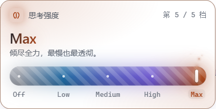

# OMP Studio 0.2.12

本版升级内置 OMP Runtime 到 19.2.1，并带来新的思考强度滑块、可选且可拖动的 Web 访问控制条、侧栏活动排序和审批恢复改进。

## 下载安装

| 系统 | 安装包 |
|---|---|
| Windows x64 | [下载 Setup](https://github.com/the-snowpear/omp-studio/releases/download/v0.2.12/OMP-Studio-Setup-0.2.12-windows-x64.exe) |
| Windows ARM64 | [下载 Setup](https://github.com/the-snowpear/omp-studio/releases/download/v0.2.12/OMP-Studio-Setup-0.2.12-windows-arm64.exe) |
| macOS Apple Silicon | [下载 DMG](https://github.com/the-snowpear/omp-studio/releases/download/v0.2.12/OMP-Studio-0.2.12-macos-arm64.dmg) · [应用更新 ZIP](https://github.com/the-snowpear/omp-studio/releases/download/v0.2.12/OMP-Studio-0.2.12-macos-arm64.zip) |
| Linux x64 | [下载 deb](https://github.com/the-snowpear/omp-studio/releases/download/v0.2.12/OMP-Studio-0.2.12-linux-x64.deb) · [下载 AppImage](https://github.com/the-snowpear/omp-studio/releases/download/v0.2.12/OMP-Studio-0.2.12-linux-x64.AppImage) |

已安装版本可在「设置 → 更新与维护」检查更新。Linux 要求支持 AVX2 的 x64 处理器和 glibc 2.39 或更新版本。macOS 包采用 ad hoc 签名。 [安装指南](https://github.com/the-snowpear/omp-studio/blob/v0.2.12/docs/getting-started.md)

## 思考强度滑块

在 Composer 和模型菜单中，新的滑块提供 Off、Low、Medium、High、Max 五档思考强度。可以拖动滑块、点击档位或使用键盘调整；选择会按当前会话排队，关闭弹层后仍保留，切换模型时不会串到其他会话。

## OMP Runtime 19.2.1

内置 Runtime 升级到 `19.2.1-studio.4`，同步 OMP 19.2.1 的会话生命周期、Agent、模型目录、后台任务和工作台状态。迁移细节见 [OMP 19.2.1 迁移报告](https://github.com/the-snowpear/omp-studio/blob/v0.2.12/docs/migrations/omp-19.2.1.md)。

## Web 访问与审批

- Web 访问控制条移入设置，可选择启用或关闭，支持底部停靠、自由拖动、键盘操作、每设备位置记忆和恢复默认位置。
- 控制条会避让审批卡片，审批按钮不再被遮挡。 [#75](https://github.com/the-snowpear/omp-studio/issues/75)
- “本会话允许”和“允许一次”失败时保留输入，显示原始错误，并可重新同步后重试。 [#76](https://github.com/the-snowpear/omp-studio/issues/76)

## 会话、模型与工作台

- 侧栏优先显示运行中和最近完成的会话，后台标题实时更新，未发送的草稿可从所属项目重新打开。
- 模型页可以独立保存 OMP 原生的供应商并发上限；Runtime 就绪后自动刷新模型目录，切换语言会保留正在编辑的值。
- OMP 19.2.1 工作台同步会话、Agent、模型、后台任务、归档和工作树状态，并保留桌面与 Web 的双端能力。
- 新增和修复覆盖 Chrome Relay、归档浏览、Todo 后端、MCP 身份验证、反汇编器与远端文件传输等边界。

## 独立 Web / SSH 运行环境

下载对应的 `omp-studio-remote-0.2.12-<平台>` 运行环境包，解压后执行 `omp-studio-web.cmd start`（Windows）或 `./omp-studio-web start`（macOS / Linux），再运行 `pair` 获取配对链接。提供 Windows、macOS、Linux 的 x64 / ARM64 六种运行环境。

| 独立 Web / SSH 运行环境 | x64 | ARM64 |
|---|---|---|
| Windows | [ZIP](https://github.com/the-snowpear/omp-studio/releases/download/v0.2.12/omp-studio-remote-0.2.12-win32-x64.zip) | [ZIP](https://github.com/the-snowpear/omp-studio/releases/download/v0.2.12/omp-studio-remote-0.2.12-win32-arm64.zip) |
| macOS | [tar.gz](https://github.com/the-snowpear/omp-studio/releases/download/v0.2.12/omp-studio-remote-0.2.12-darwin-x64.tar.gz) | [tar.gz](https://github.com/the-snowpear/omp-studio/releases/download/v0.2.12/omp-studio-remote-0.2.12-darwin-arm64.tar.gz) |
| Linux | [tar.gz](https://github.com/the-snowpear/omp-studio/releases/download/v0.2.12/omp-studio-remote-0.2.12-linux-x64.tar.gz) | [tar.gz](https://github.com/the-snowpear/omp-studio/releases/download/v0.2.12/omp-studio-remote-0.2.12-linux-arm64.tar.gz) |

完整运行时与远端包会在发布工作流中签名并上传；Linux x64 需要 AVX2 与 glibc 2.39+，macOS 包采用 ad hoc 签名。

## English

OMP Studio 0.2.12 upgrades the bundled OMP Runtime to 19.2.1 and adds a new thinking intensity slider, an optional draggable Web access bar, activity-aware session ordering and stronger approval recovery.

### Downloads

| Platform | Installer |
|---|---|
| Windows x64 | [Setup](https://github.com/the-snowpear/omp-studio/releases/download/v0.2.12/OMP-Studio-Setup-0.2.12-windows-x64.exe) |
| Windows ARM64 | [Setup](https://github.com/the-snowpear/omp-studio/releases/download/v0.2.12/OMP-Studio-Setup-0.2.12-windows-arm64.exe) |
| macOS Apple Silicon | [DMG](https://github.com/the-snowpear/omp-studio/releases/download/v0.2.12/OMP-Studio-0.2.12-macos-arm64.dmg) · [Update ZIP](https://github.com/the-snowpear/omp-studio/releases/download/v0.2.12/OMP-Studio-0.2.12-macos-arm64.zip) |
| Linux x64 | [deb](https://github.com/the-snowpear/omp-studio/releases/download/v0.2.12/OMP-Studio-0.2.12-linux-x64.deb) · [AppImage](https://github.com/the-snowpear/omp-studio/releases/download/v0.2.12/OMP-Studio-0.2.12-linux-x64.AppImage) |

Installed versions can check for updates in Settings → Updates & Maintenance. Linux requires an AVX2-capable x64 processor and glibc 2.39+. macOS packages use ad hoc signing. [Installation guide](https://github.com/the-snowpear/omp-studio/blob/v0.2.12/docs/getting-started.md)

### Thinking intensity slider

The Composer and model menu now share a five-level slider: Off, Low, Medium, High and Max. Drag, click a tick or use the keyboard to change the level. Choices stay queued for the active conversation after the popover closes and remain isolated when models or conversations change.

### OMP Runtime 19.2.1

The bundled Runtime is `19.2.1-studio.4`, carrying the OMP 19.2.1 session, Agent, model catalog, background-task and workbench updates. See the [OMP 19.2.1 migration report](https://github.com/the-snowpear/omp-studio/blob/v0.2.12/docs/migrations/omp-19.2.1.md).

### Web access and approvals

- Web access control moves into Settings with optional enablement, bottom docking, free dragging, keyboard actions, per-device position memory and reset-to-default.
- The bar reserves space around approval cards, so approval actions stay visible. [#75](https://github.com/the-snowpear/omp-studio/issues/75)
- Failed “Allow for session” and “Allow once” responses preserve input, show the original error and can retry after an explicit snapshot sync. [#76](https://github.com/the-snowpear/omp-studio/issues/76)

### Sessions, models and workbench

- The sidebar prioritizes running and recently completed sessions, refreshes resident titles live and restores unsent drafts from their project.
- The model page saves OMP-native provider concurrency limits independently, refreshes the catalog when Runtime becomes ready and preserves edits across language changes.
- The OMP 19.2.1 workbench keeps session, Agent, model, background-task, archive and worktree state aligned across desktop and Web.
- Additional fixes cover Chrome Relay, archive browsing, the Todo backend, MCP authentication, the disassembler and remote file transfers.

### Standalone Web / SSH environments

Download the matching `omp-studio-remote-0.2.12-<platform>` environment archive, extract it and run `omp-studio-web.cmd start` (Windows) or `./omp-studio-web start` (macOS / Linux), then run `pair` to obtain a pairing link. Six Windows, macOS and Linux x64/ARM64 environments are available.

| Standalone Web / SSH environment | x64 | ARM64 |
|---|---|---|
| Windows | [ZIP](https://github.com/the-snowpear/omp-studio/releases/download/v0.2.12/omp-studio-remote-0.2.12-win32-x64.zip) | [ZIP](https://github.com/the-snowpear/omp-studio/releases/download/v0.2.12/omp-studio-remote-0.2.12-win32-arm64.zip) |
| macOS | [tar.gz](https://github.com/the-snowpear/omp-studio/releases/download/v0.2.12/omp-studio-remote-0.2.12-darwin-x64.tar.gz) | [tar.gz](https://github.com/the-snowpear/omp-studio/releases/download/v0.2.12/omp-studio-remote-0.2.12-darwin-arm64.tar.gz) |
| Linux | [tar.gz](https://github.com/the-snowpear/omp-studio/releases/download/v0.2.12/omp-studio-remote-0.2.12-linux-x64.tar.gz) | [tar.gz](https://github.com/the-snowpear/omp-studio/releases/download/v0.2.12/omp-studio-remote-0.2.12-linux-arm64.tar.gz) |

Full Runtime and remote archives are signed by the release workflow. Linux x64 requires AVX2 and glibc 2.39+; macOS packages use ad hoc signatures.

Runtime identity is `19.2.1-studio.4`. Windows x64 receives local browser and Electron evidence; macOS, Linux and Windows ARM64 rely on the release packaging checks and have not received local physical-device acceptance in this review. See the [verification record](https://github.com/the-snowpear/omp-studio/blob/v0.2.12/docs/reviews/v0.2.12-release-review.md).

[完整变更 / Full diff](https://github.com/the-snowpear/omp-studio/compare/v0.2.11...v0.2.12) · [Changelog](https://github.com/the-snowpear/omp-studio/blob/v0.2.12/CHANGELOG.md#0212---2026-11-28)
