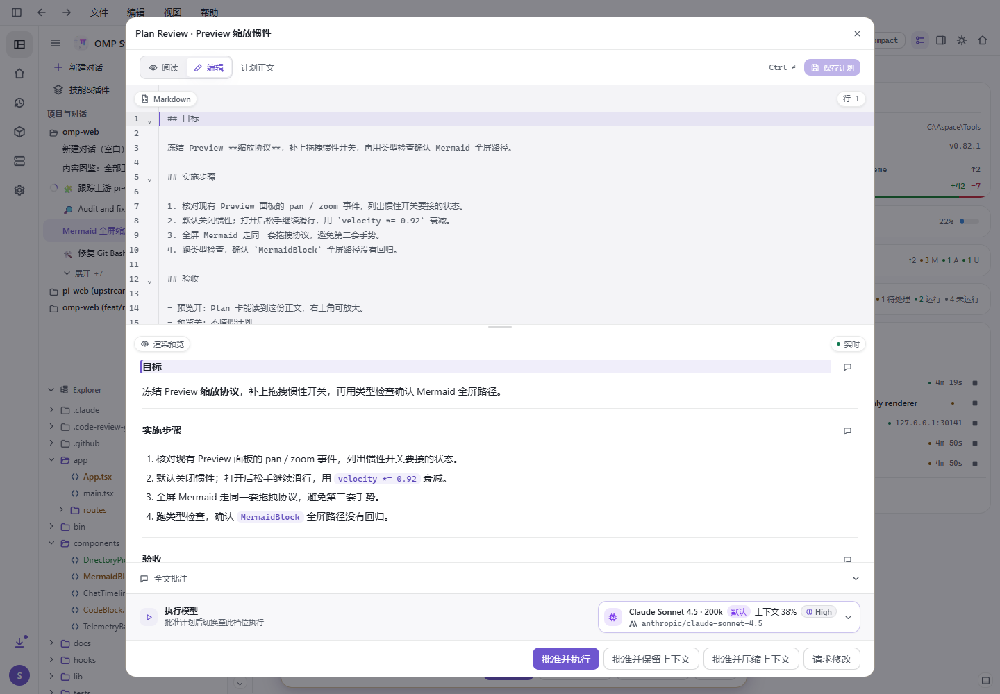
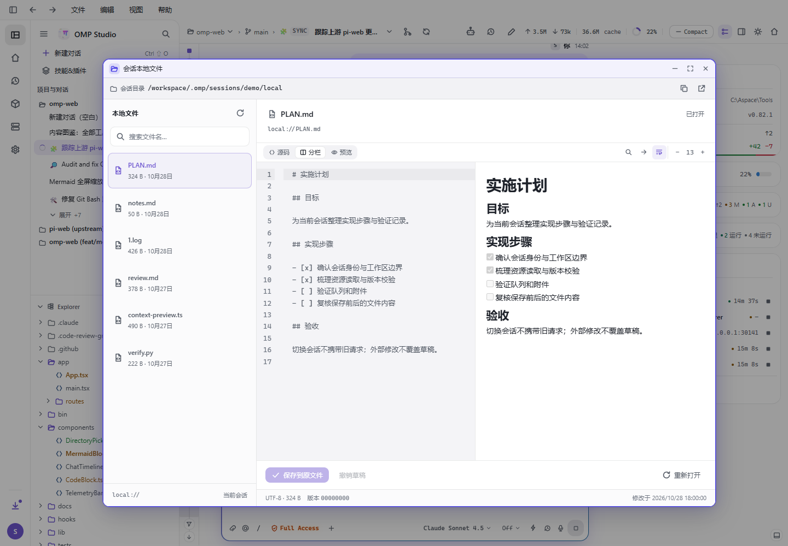
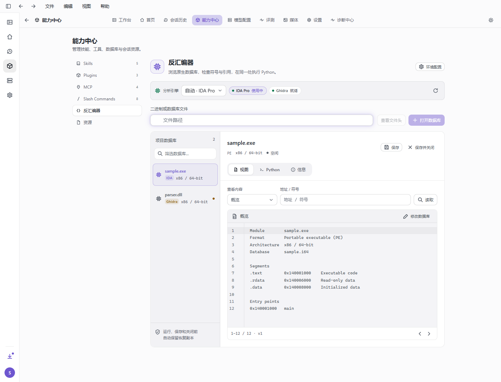

# OMP Studio 0.2.7

本版升级至 **OMP 19.0.1**，内置 Runtime 为 **`19.0.1-studio.1`**。重点更新 Plan 评审编辑、会话文件与完整输出、反汇编工作台，并改善长对话、大型评测报告和 3D 预览的响应。

## 在评审里直接修改计划

计划可以切换阅读和编辑模式，Markdown 源码与实时预览可互相定位，编辑区高度可拖动调整。支持查找替换、章节批注和全文批注；收起再打开、切换中英文时保留草稿、光标、撤销历史与批注。

批准执行、请求修改或保存退出前会先保存修改后的正文。保存或提交失败时继续显示原计划和错误原因，便于重试。

## 会话文件与日志成为工作台窗口

`/local` 打开当前会话的文件窗口，也可以直接指定文件。窗口支持移动、停靠与缩放；Markdown 文件有源码、预览和分栏视图，文本可查找、跳转到行、调整换行与字号。

工具的完整输出链接在独立窗口中打开，保留日志颜色、跨页样式和常见级别提示。重新打开或切换文件时，会先处理未保存的草稿。

## 统一反汇编工作台

支持 IDA Pro、Ghidra、自动选择和仅头部元数据模式。新增工作台快捷卡，数据库、函数、查询及带预览的编辑操作集中在同一面板；旧 IDA 面板位置会迁移到统一反汇编器。

以上截图来自本版实际组件，使用演示数据展示界面。

## OMP 19 适配与性能

- Ask 表单采用连续折叠布局，选项附注可附图片；输入框以 `?` 发起 BTW，回答可在时间线便签或面板中继续处理。
- 同步后台交接、Daemon、Agent 等待关系、工作树状态、Kiro 多账号、Claude 订阅信息，以及 Live 端点与音色配置。模型菜单增加供应商筛选与 `provider/model` 搜索。
- 减少流式消息的重复拷贝与代码块重绘，改善评测报告翻页、3D 模型法线和贴图处理、会话切换与空闲开销。性能数据的机器、样本和边界见[实测记录](https://github.com/the-snowpear/omp-studio/blob/v0.2.7/docs/reviews/runtime-performance-2026-11-19.md)。
- 修复后台交接后的导航、会话文件与日志归属、跨会话浮窗焦点和编辑状态保留问题。移除上游已经删除的 Seance 入口。

## 下载安装

已有可用桌面版可以在「设置 → 更新与维护」检查更新，也可以直接下载对应系统的安装包。0.2.5 若无法启动，请运行新版完整安装包。本版包含桌面与 Runtime 的配套变更，建议完整更新。

| 系统 | 安装包 |
|---|---|
| Windows x64 | [下载 Setup](https://github.com/the-snowpear/omp-studio/releases/download/v0.2.7/OMP-Studio-Setup-0.2.7-windows-x64.exe) |
| Windows ARM64 | [下载 Setup](https://github.com/the-snowpear/omp-studio/releases/download/v0.2.7/OMP-Studio-Setup-0.2.7-windows-arm64.exe) |
| macOS Apple Silicon | [下载 DMG](https://github.com/the-snowpear/omp-studio/releases/download/v0.2.7/OMP-Studio-0.2.7-macos-arm64.dmg) · [应用更新 ZIP](https://github.com/the-snowpear/omp-studio/releases/download/v0.2.7/OMP-Studio-0.2.7-macos-arm64.zip) |
| Linux x64 | [下载 deb](https://github.com/the-snowpear/omp-studio/releases/download/v0.2.7/OMP-Studio-0.2.7-linux-x64.deb) · [下载 AppImage](https://github.com/the-snowpear/omp-studio/releases/download/v0.2.7/OMP-Studio-0.2.7-linux-x64.AppImage) |

Linux 包要求支持 AVX2 的 x64 处理器及 glibc 2.39 或更新版本。macOS 包为 ad hoc 签名，尚未进行 Apple 公证。IDA／Ghidra、Kiro 登录及外部 Live 服务需要各自的安装或账户。

[完整变更记录](https://github.com/the-snowpear/omp-studio/compare/v0.2.6...v0.2.7) · [Changelog](https://github.com/the-snowpear/omp-studio/blob/v0.2.7/CHANGELOG.md) · [安装指南](https://github.com/the-snowpear/omp-studio/blob/v0.2.7/docs/getting-started.md) · [OMP 19.0.1 迁移报告](https://github.com/the-snowpear/omp-studio/blob/v0.2.7/docs/migrations/omp-19.0.1.md)
