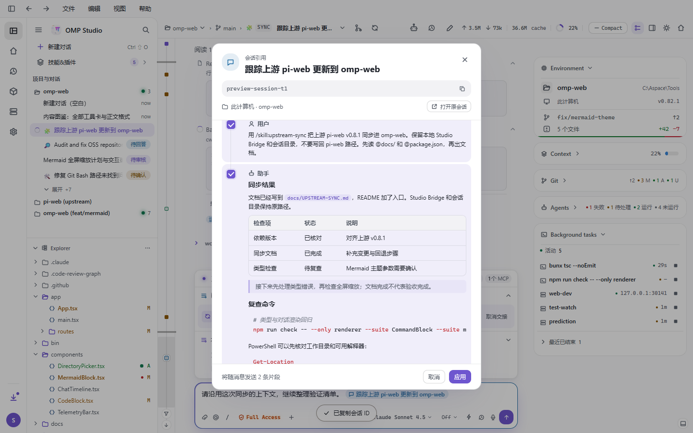
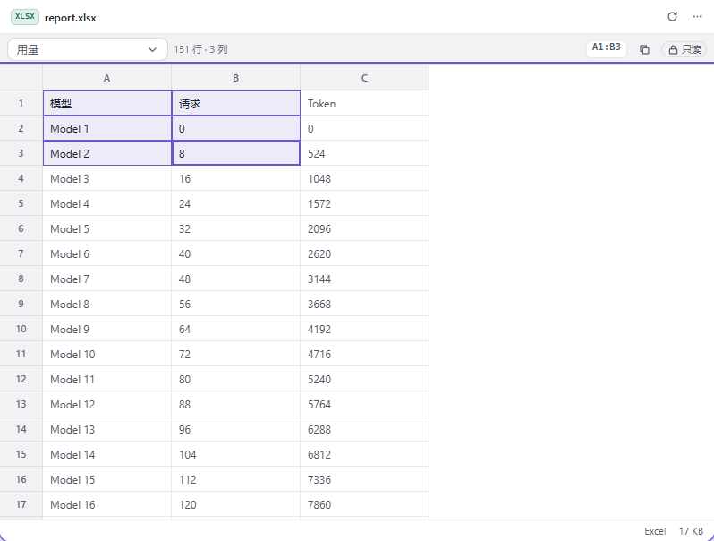
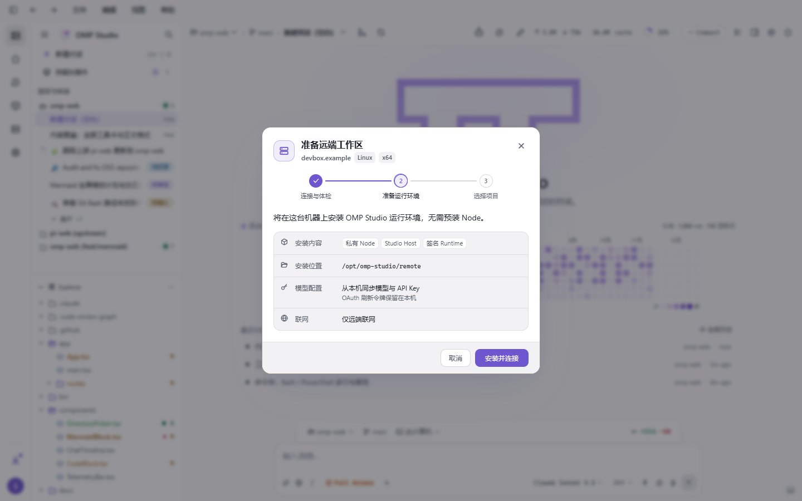

# OMP Studio 0.2.8

## 下载安装

| 系统 | 安装包 |
|---|---|
| Windows x64 | [下载 Setup](https://github.com/the-snowpear/omp-studio/releases/download/v0.2.8/OMP-Studio-Setup-0.2.8-windows-x64.exe) |
| Windows ARM64 | [下载 Setup](https://github.com/the-snowpear/omp-studio/releases/download/v0.2.8/OMP-Studio-Setup-0.2.8-windows-arm64.exe) |
| macOS Apple Silicon | [下载 DMG](https://github.com/the-snowpear/omp-studio/releases/download/v0.2.8/OMP-Studio-0.2.8-macos-arm64.dmg) · [应用更新 ZIP](https://github.com/the-snowpear/omp-studio/releases/download/v0.2.8/OMP-Studio-0.2.8-macos-arm64.zip) |
| Linux x64 | [下载 deb](https://github.com/the-snowpear/omp-studio/releases/download/v0.2.8/OMP-Studio-0.2.8-linux-x64.deb) · [下载 AppImage](https://github.com/the-snowpear/omp-studio/releases/download/v0.2.8/OMP-Studio-0.2.8-linux-x64.AppImage) |

已经安装的桌面版可在「设置 → 更新与维护」检查更新。Linux 包要求支持 AVX2 的 x64 处理器和 glibc 2.39 或更新版本。macOS 包采用 ad hoc 签名，尚未进行 Apple 公证。内置 Runtime 为 `19.0.1-studio.1`。 [安装指南](https://github.com/the-snowpear/omp-studio/blob/v0.2.8/docs/getting-started.md)

## 在对话里引用另一条会话

从对话菜单、侧栏或历史页复制会话 ID，粘贴到输入框即可生成引用。同一 ID 对应多个项目或连接时，可以选择来源。打开引用后可选取最多六条已保存的消息作为摘录，随下一条消息一起发送。也可以只发送会话 ID。

## 批量清理已归档会话

在「会话历史 → 已归档」中选择多条会话后，可以一次删除，并查看每条会话的处理结果。批量删除保留产物库中的托管产物，且会跳过已被取消归档的会话。单条会话可以从工作台侧栏或历史页的菜单删除，并可选择同时清理托管产物。

## 对话活动和 Advisor 审阅

对话底部用不同的图标显示等待、思考、回复、重试以及正在执行的文件、搜索或终端操作。Advisor 同一批的多条意见集中在一张可折叠的卡片里，含阻断问题的批次默认展开，也可以直接复制整批意见。

## 文件窗口支持更多表格和 Office 格式

`.xlsm`、`.xlsb` 和 `.ods` 可直接预览。使用方向键、Home / End 或 Page Up / Down 浏览单元格，按住 Shift 扩展选区并复制。可选的 Office 组件新增 `.docm` 和 `.pptm`，转换时禁用宏。 [文件窗口说明](https://github.com/the-snowpear/omp-studio/blob/v0.2.8/docs/file-viewer.md)

## SSH 与 WSL 连接准备

连接表单把网络策略和安装目录放在可展开的高级设置中。准备环境时可以确认目标系统、安装内容和保存位置，并查看下载、上传、安装、验证各阶段的进度。SSH 上传根据远端系统选择传输方式，按远端收到的字节数报告进度，安装前校验文件大小和 SHA-256。 [SSH 工作区](https://github.com/the-snowpear/omp-studio/blob/v0.2.8/docs/ssh-workspaces.md)

截图由本版界面使用演示数据截取。

[完整变更记录](https://github.com/the-snowpear/omp-studio/compare/v0.2.7...v0.2.8) · [Changelog](https://github.com/the-snowpear/omp-studio/blob/v0.2.8/CHANGELOG.md)
