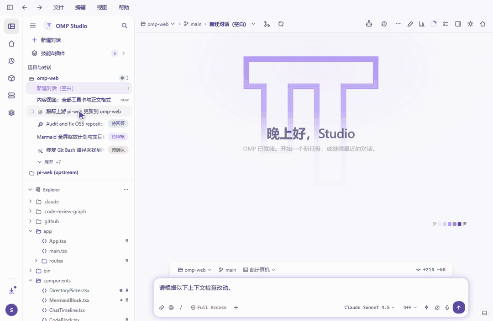

# OMP Studio 0.2.9

## 下载安装

| 系统 | 安装包 |
|---|---|
| Windows x64 | [下载 Setup](https://github.com/the-snowpear/omp-studio/releases/download/v0.2.9/OMP-Studio-Setup-0.2.9-windows-x64.exe) |
| Windows ARM64 | [下载 Setup](https://github.com/the-snowpear/omp-studio/releases/download/v0.2.9/OMP-Studio-Setup-0.2.9-windows-arm64.exe) |
| macOS Apple Silicon | [下载 DMG](https://github.com/the-snowpear/omp-studio/releases/download/v0.2.9/OMP-Studio-0.2.9-macos-arm64.dmg) · [应用更新 ZIP](https://github.com/the-snowpear/omp-studio/releases/download/v0.2.9/OMP-Studio-0.2.9-macos-arm64.zip) |
| Linux x64 | [下载 deb](https://github.com/the-snowpear/omp-studio/releases/download/v0.2.9/OMP-Studio-0.2.9-linux-x64.deb) · [下载 AppImage](https://github.com/the-snowpear/omp-studio/releases/download/v0.2.9/OMP-Studio-0.2.9-linux-x64.AppImage) |

已安装的桌面版可在「设置 → 更新与维护」检查更新。内置 Runtime 为 `19.0.1-studio.1`。Linux 包要求支持 AVX2 的 x64 处理器和 glibc 2.39 或更新版本。macOS 包采用 ad hoc 签名。 [安装指南](https://github.com/the-snowpear/omp-studio/blob/v0.2.9/docs/getting-started.md)

## 拖进输入框，变成引用胶囊

把侧栏会话、对话窗口或 Explorer 文件和文件夹拖到输入框，在插入光标处松手。胶囊可以在草稿里重排，也可以拖到另一个输入框。把可打开的文件或会话胶囊拖回工作台，就能打开对应窗口。文件引用使用来源工作区中的路径，已附在会话引用里的摘录会一起移动。

演示由本版工作台使用示例数据录制。

## Agent 与工作台

子 Agent 的像素头像现在贯穿对话、悬停预览、名册和停靠窗口。子 Agent 对话顶部可以通过头像切换会话。Plan 紧凑卡调整了正文滚动和底部渐变，主题切换动画随操作位置展开。

## 修复

- 项目行的「⋯」恢复项目操作菜单。 [#63](https://github.com/the-snowpear/omp-studio/issues/63)
- 减少子 Agent 运行时编排窗口的闪烁，从 Agent 详情也能直接切换编队、时间线和星图。 [#64](https://github.com/the-snowpear/omp-studio/issues/64) · [#65](https://github.com/the-snowpear/omp-studio/issues/65)
- Worktree 启动确认期间可以继续键入草稿。「创建并进入」和「留在当前工作区」会使用当前 Runtime 会话。 [#66](https://github.com/the-snowpear/omp-studio/issues/66) · [#67](https://github.com/the-snowpear/omp-studio/issues/67)
- 修复 Markdown 文件引用打开前的路径解析。子 Agent 悬停预览可移入滚动，右侧工具区可随窗口加宽。
- 拖放相对文件路径时避免引用到其他工作区，文件打不开时保留草稿胶囊，移动会话引用时保留摘录。

[完整变更记录](https://github.com/the-snowpear/omp-studio/compare/v0.2.8...v0.2.9) · [Changelog](https://github.com/the-snowpear/omp-studio/blob/v0.2.9/CHANGELOG.md)
